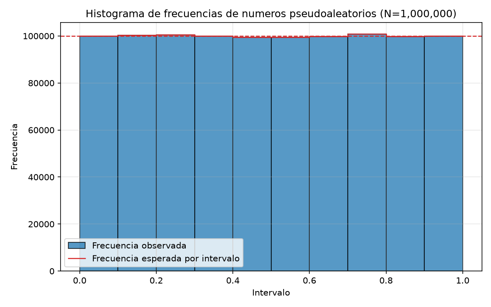
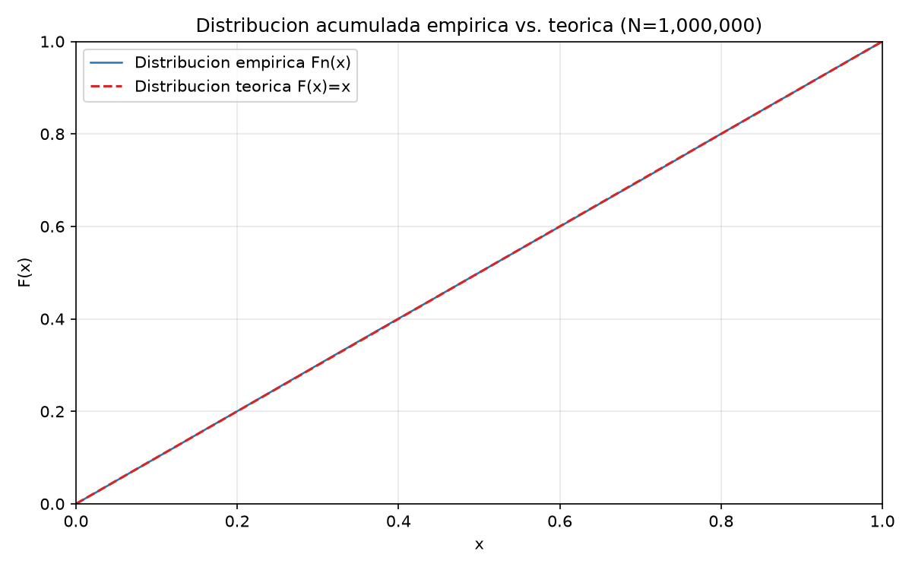
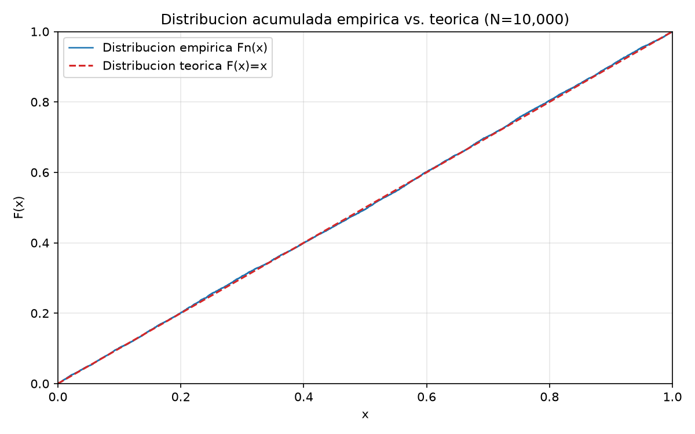
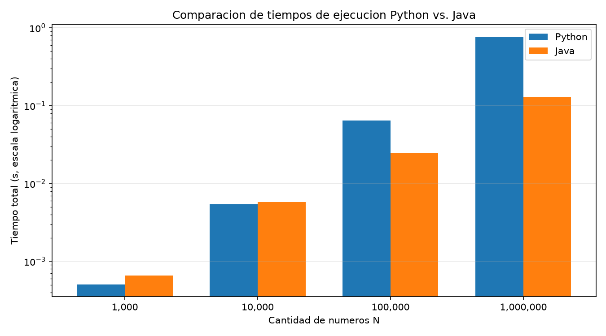

# Práctica N.º 06: Validación estadística de números pseudoaleatorios mediante Chi-cuadrado y Kolmogorov-Smirnov


**Práctica:** Validación estadística de números pseudoaleatorios mediante Chi-cuadrado y Kolmogorov-Smirnov  
**Asignatura:** Simulación — Ciclo 5, Carrera de Computación  
**Universidad:** Universidad Nacional de Loja — FEIRNNR  
**Estudiante:** Emilio Jose Galvez Merchan  
**Docente:** José O. Guamán Q.  
**Implementaciones:** Python 3.14 y Java 17+ (probado con OpenJDK 25)

---

## Contenido

1. [Descripción del proyecto](#1-descripción-del-proyecto)
2. [Tecnologías utilizadas](#2-tecnologías-utilizadas)
3. [Instalación](#3-instalación)
4. [Configuración](#4-configuración)
5. [Uso](#5-uso)
6. [Estructura del proyecto](#6-estructura-del-proyecto)
7. [Información adicional](#7-información-adicional)

---

## 1. Descripción del proyecto

Esta práctica valida la calidad estadística de una secuencia de números
pseudoaleatorios generada con un **Generador Congruencial Lineal (LCG)**. El
generador produce estados enteros con la recurrencia

```text
X(n+1) = (a · X(n) + c) mod m
```

y normaliza cada estado al intervalo `[0, 1)` mediante

```text
U(n) = X(n) / m
```

La hipótesis de trabajo es:

- **H0:** los números generados siguen una distribución uniforme `U(0, 1)`.
- **H1:** los números generados no siguen una distribución uniforme `U(0, 1)`.

Para decidir entre ambas hipótesis se aplican dos pruebas de bondad de ajuste:

1. **Chi-cuadrado (χ²):** divide `[0, 1]` en 10 subintervalos y compara las
   frecuencias observadas con las esperadas. Los grados de libertad son
   `gl = k − 1 = 9`.
2. **Kolmogorov-Smirnov (KS):** compara la función de distribución acumulada
   empírica con la distribución teórica `F(x) = x` y calcula el estadístico `D`.

Con `α = 0.05`, se rechaza H0 cuando `p < 0.05`.

El proyecto contiene **dos implementaciones independientes**, una en Python y
otra en Java, que producen exactamente la misma secuencia de estados y los
mismos resultados estadísticos. Además de la semilla base 12 345, se evaluaron
las semillas 54 321 y 2 026 para analizar la sensibilidad del generador.

Los resultados completos, las tablas y las gráficas están documentados en
[`documentation/informe.md`](documentation/informe.md).

---

## 2. Tecnologías utilizadas

| Tecnología | Versión probada | Para qué se usa |
|---|---|---|
| **Python** | 3.14.4 | Implementación del LCG, pruebas estadísticas y análisis |
| **Java** | 17+ (OpenJDK 25) | Implementación equivalente del LCG y las pruebas |
| **NumPy** | 2.5.3 | Arreglos y operaciones numéricas para las gráficas |
| **Pandas** | 3.1.1 | Lectura y exportación de resultados en CSV |
| **Matplotlib** | 3.11.2 | Histogramas, ECDF y gráficas comparativas |
| **Pytest** | 9.2.0 | Pruebas automatizadas de Python |
| **JUnit 5** | 5.10.2 | Pruebas automatizadas de Java (gestionadas por Maven) |

Java no requiere bibliotecas externas en tiempo de ejecución. Las dependencias
de Python están fijadas en [`requirements.txt`](requirements.txt).

---

## 3. Instalación

### 3.1 Requisitos

- Python 3.10 o superior (probado con 3.14.4).
- Java 17 o superior (probado con OpenJDK 25).
- Maven 3.8 o superior, solo si se desea compilar Java con Maven.
- `pip` para instalar las dependencias de Python.

### 3.2 Entorno virtual e instalación de Python

El entorno virtual del repositorio está en la carpeta superior a `practica6/`.
Los comandos son para Linux o WSL:

```bash
# 1. Ir a la carpeta que contiene el entorno virtual
cd ~/simulacion

# 2. Activar el entorno virtual
source venv/bin/activate

# 3. Instalar las dependencias de la práctica
pip install -r Unidad2/practica6/requirements.txt
```

Si se prefiere crear un entorno nuevo dentro de la práctica:

```bash
cd Unidad2/practica6
python3 -m venv .venv
source .venv/bin/activate
pip install -r requirements.txt
```

### 3.3 Java

El `pom.xml` ya declara JUnit 5 y el compilador de Java 17. Maven descarga las
dependencias automáticamente:

```bash
cd Unidad2/practica6/java
mvn clean package
```

Si no se dispone de Maven, se puede compilar directamente con `javac`:

```bash
cd Unidad2/practica6/java
mkdir -p build/classes
javac -encoding UTF-8 -d build/classes $(find src/main/java -name "*.java")
```

---

## 4. Configuración

Los parámetros compartidos por Python y Java se encuentran en
[`config/simulation.properties`](config/simulation.properties):

| Parámetro | Valor | Descripción |
|---|---:|---|
| `seed` | 12 345 | Semilla inicial `X(0)` |
| `multiplier` | 1 664 525 | Multiplicador `a` |
| `increment` | 1 013 904 223 | Incremento `c` |
| `modulus` | 4 294 967 296 | Módulo `m = 2³²` |
| `alpha` | 0.05 | Nivel de significancia |
| `bins` | 10 | Número de intervalos para χ² |
| `sample.sizes` | 1000, 10000, 100000, 1000000 | Tamaños de muestra |

Ejemplo de configuración:

```properties
seed=12345
multiplier=1664525
increment=1013904223
modulus=4294967296
alpha=0.05
bins=10
sample.sizes=1000,10000,100000,1000000
```

Para cambiar la semilla o los tamaños de muestra basta con editar este archivo.
Ambos programas leen la misma configuración y escriben sus resultados en sus
respectivas carpetas.

> **Nota sobre π:** la columna «π estimado» de la guía se calcula con la serie
> determinista de Leibniz. No proviene de la secuencia del LCG y, por tanto, no
> depende de la semilla. Se incluye solo para completar la tabla solicitada.

---

## 5. Uso

Todos los comandos se ejecutan desde la raíz de la práctica:

```bash
cd ~/simulacion/Unidad2/practica6
```

### 5.1 Python

Ejecución completa (generación, χ², KS, estimación de π, comparación y gráficas):

```bash
python python/src/main.py
```

Opciones disponibles:

```bash
python python/src/main.py --sizes 1000,10000        # tamaños personalizados
python python/src/main.py --config ruta/config.properties
python python/src/main.py --no-compare              # solo simulación
python python/src/main.py --no-plots                # comparación sin gráficas
python python/src/main.py --compare-only            # solo comparación y gráficas
python python/src/main.py --no-warmup               # sin calentamiento previo
```

Ejemplo de salida en consola:

```text
Resultados Python
         N      pi estimado          error     tiempo (s)       p Chi2         p KS
     1,000   3.140592653840   9.999997e-04       0.000508     0.903338     0.321240
    10,000   3.141492653590   1.000000e-04       0.005385     0.116746     0.658225
   100,000   3.141582653590   1.000000e-05       0.064173     0.422638     0.594560
 1,000,000   3.141591653590   1.000000e-06       0.766926     0.066409     0.287831
```

### 5.2 Java

Con Maven:

```bash
cd java
mvn clean package
java -cp target/classes simulation.Main
```

Con `javac`:

```bash
cd java
mkdir -p build/classes
javac -encoding UTF-8 -d build/classes $(find src/main/java -name "*.java")
java -cp build/classes simulation.Main
```

Para usar otro archivo de configuración:

```bash
java -cp build/classes simulation.Main ruta/al/simulation.properties
```

También se puede indicar con una propiedad del sistema:

```bash
java -Dsim.config=ruta/al/simulation.properties -cp build/classes simulation.Main
```

### 5.3 Comparación y gráficas

Cuando ambos lenguajes ya generaron sus resultados, la comparación se puede
ejecutar solo con Python:

```bash
python python/src/main.py --compare-only
```

Esta orden:

- lee los CSV de `python/results/` y `java/results/`;
- verifica que las secuencias de estados sean idénticas;
- genera `results/comparison/comparison.csv`;
- genera las tablas `results/comparison/tabla_python_java.csv`,
  `tabla_por_lenguaje.csv` y `tabla_semillas.csv`;
- genera las gráficas en `results/plots/`.

> Las secuencias de 100 000 y 1 000 000 de números no se versionan por su
> tamaño. Se regeneran automáticamente al ejecutar las implementaciones de
> Python y Java.

### 5.4 Pruebas automatizadas

Python:

```bash
python -m pytest -q python/tests
```

Resultado esperado: **27 pruebas aprobadas**.

Java, con Maven:

```bash
cd java
mvn test
```

---

## 6. Estructura del proyecto

```text
practica6/
├── config/
│   └── simulation.properties          # Parámetros compartidos por Python y Java
├── documentation/
│   └── informe.md                     # Informe completo de la práctica
├── java/
│   ├── pom.xml                        # Configuración Maven y JUnit 5
│   ├── src/main/java/simulation/
│   │   ├── Main.java                  # Punto de entrada Java
│   │   ├── config/                    # Lectura de configuración
│   │   ├── generators/                # LCG en Java
│   │   ├── models/                    # Resultados y tiempos
│   │   ├── services/                  # Simulación y exportación CSV
│   │   ├── simulation/                # Estimación de π
│   │   └── statistics/                # χ², KS y funciones especiales
│   ├── src/test/java/simulation/      # Pruebas JUnit 5
│   ├── build/classes/                 # Compilación local con javac
│   └── results/                       # Secuencias, estadísticas y resúmenes Java
├── python/
│   ├── src/
│   │   ├── main.py                    # Punto de entrada Python
│   │   ├── config.py                  # Lectura de configuración
│   │   ├── generators/                # LCG en Python
│   │   ├── models/                    # Resultados y tiempos
│   │   ├── services/                  # Simulación, exportación y comparación
│   │   ├── simulation/                # Estimación de π
│   │   ├── statistics/                # χ², KS y funciones especiales
│   │   └── visualization/             # Gráficas con Matplotlib
│   ├── tests/                         # Pruebas Pytest
│   └── results/                       # Secuencias, estadísticas y resúmenes Python
├── results/
│   ├── comparison/                    # Comparación Python vs. Java y tablas
│   └── plots/                         # Histogramas, ECDF y gráficas de tiempos
├── Practica_6_ChiCuadrado_KS_Emilio_Galvez.pdf
├── requirements.txt                   # Dependencias de Python con versiones fijadas
└── README.md                          # Este archivo
```

### Flujo de ejecución

```text
config/simulation.properties
             │
             ├──> Python: LCG → χ² → KS → π → CSV ─┐
             │                                      ├──> results/comparison/
             └──> Java:   LCG → χ² → KS → π → CSV ─┘         results/plots/
```

Ambos lenguajes exportan:

- `results/sequences/sequence_<N>.csv`: índice, estado y valor uniforme.
- `results/statistics/chi_square.csv`: frecuencias observadas/esperadas, χ²,
  grados de libertad, valor p y decisión.
- `results/statistics/kolmogorov_smirnov.csv`: `D+`, `D−`, `D`, valor p y
  decisión.
- `results/performance/timings.csv`: tiempos por etapa.
- `results/summary/pi_table.csv`: π estimado, error y tiempo total.

---

## 7. Información adicional

### 7.1 Funcionalidades principales

- LCG implementado en Python y Java con parámetros configurables.
- Generación de secuencias de 1 000 a 1 000 000 de números.
- Prueba χ² con 10 intervalos, 9 grados de libertad y frecuencias esperadas.
- Prueba KS con cálculo de `D+`, `D−` y `D`, valor p con corrección de Stephens.
- Cálculo de valores p sin depender de SciPy: gamma incompleta regularizada y
  serie de Kolmogorov.
- Comparación automática entre Python y Java, incluyendo verificación de
  secuencias idénticas.
- Exportación de resultados a CSV.
- Gráficas de histogramas, ECDF, tiempos de ejecución y error de π.
- Ejecución con varias semillas para analizar sensibilidad.
- Pruebas automatizadas en Python y Java.

### 7.2 Resultados obtenidos

Resultados con la semilla base 12 345. Python y Java producen los mismos
valores:

| N | χ² | gl | p(χ²) | D | p(KS) | Decisión |
|---:|---:|---:|---:|---:|---:|---|
| 1 000 | 4.120000 | 9 | 0.903338 | 0.028642 | 0.321240 | No se rechaza H0 |
| 10 000 | 14.160000 | 9 | 0.116746 | 0.005960 | 0.658225 | No se rechaza H0 |
| 100 000 | 9.160000 | 9 | 0.422638 | 0.002073 | 0.594560 | No se rechaza H0 |
| 1 000 000 | 16.022720 | 9 | 0.066409 | 0.000944 | 0.287831 | No se rechaza H0 |

Con las semillas adicionales 54 321 y 2 026 tampoco se rechazó H0 en ninguna
prueba. El valor p más pequeño del experimento fue **0.066409**, superior a
`α = 0.05`.

La comparación entre lenguajes mostró:

- secuencias de estados idénticas para los cuatro tamaños;
- `máx |U_Python − U_Java| = 0.0`;
- diferencias nulas en χ², `D`, `p(χ²)` y `p(KS)`.

### 7.3 Gráficas generadas

Todas las imágenes están en [`results/plots/`](results/plots/).

| Histograma N = 1 000 000 | ECDF frente a la teórica N = 1 000 000 |
|---|---|
|  |  |

| ECDF N = 10 000 | Comparación de tiempos Python vs. Java |
|---|---|
|  |  |

También se generan los histogramas y las ECDF para `N = 1 000`, `N = 10 000`,
`N = 100 000` y `N = 1 000 000`, además de la gráfica del error de π.

### 7.4 Tablas y archivos de resultados

| Archivo | Contenido |
|---|---|
| [`results/comparison/tabla_python_java.csv`](results/comparison/tabla_python_java.csv) | Tabla comparativa Python vs. Java con χ², gl, p(χ²), D, p(KS) y decisión |
| [`results/comparison/tabla_por_lenguaje.csv`](results/comparison/tabla_por_lenguaje.csv) | Resultados por semilla, lenguaje y tamaño de muestra |
| [`results/comparison/tabla_semillas.csv`](results/comparison/tabla_semillas.csv) | Resumen de las tres semillas |
| [`results/comparison/comparison.csv`](results/comparison/comparison.csv) | Comparación completa con diferencias numéricas |
| [`results/comparison/pi_table.csv`](results/comparison/pi_table.csv) | π estimado, error y tiempos |
| [`documentation/informe.md`](documentation/informe.md) | Informe completo con marco teórico, resultados y conclusiones |
| [`Practica_6_ChiCuadrado_KS_Emilio_Galvez.pdf`](Practica_6_ChiCuadrado_KS_Emilio_Galvez.pdf) | Documento final de la práctica |

### 7.5 Nota sobre la estimación de π

La guía incluye una tabla de π estimado, error y tiempos. En este proyecto esa
columna se calculó con la serie alterna de Leibniz:

```text
π ≈ 4 Σ (-1)^k / (2k + 1),   k = 0, ..., N-1
```

Es un cálculo determinista: no usa la secuencia del LCG ni cambia con la
semilla. Por eso el valor de π es el mismo en Python, en Java y en las tres
semillas. Se reporta solo para completar la tabla de la guía; la validación del
generador se basa en χ² y KS.

### 7.6 Referencias

- Guamán Q., J. O. *Guía de Actividades Práctico-Experimentales Nro. 006:
  Validación estadística de números pseudoaleatorios mediante Chi-cuadrado y
  Kolmogorov-Smirnov*. FEIRNNR, Carrera de Computación, 2026.
- Law, A. M. *Simulation Modeling and Analysis*. 5.ª ed. McGraw-Hill, 2015.
- Knuth, D. E. *The Art of Computer Programming, Vol. 2: Seminumerical
  Algorithms*. 3.ª ed. Addison-Wesley, 1997.
- Stephens, M. A. «Use of the Kolmogorov-Smirnov, Cramér-von Mises and Related
  Statistics Without Extensive Tables». *Journal of the Royal Statistical
  Society, Series B*, 32(1), 1970, pp. 115-122.
- Numerical Recipes Software. *Numerical Recipes: The Art of Scientific
  Computing*. 3.ª ed. Cambridge University Press, 2007.

### 7.7 Datos académicos

| | |
|---|---|
| **Universidad** | Universidad Nacional de Loja — FEIRNNR |
| **Carrera** | Computación — Ciclo 5 |
| **Asignatura** | Simulación |
| **Práctica** | N.º 06 — Validación estadística de números pseudoaleatorios mediante Chi-cuadrado y Kolmogorov-Smirnov |
| **Docente** | José O. Guamán Q. |
| **Autor** | Emilio Jose Galvez Merchan |
| **Fecha** | 14 de noviembre de 2026 |

### Licencia

Proyecto de uso académico, desarrollado como parte de la práctica de la
asignatura Simulación.
