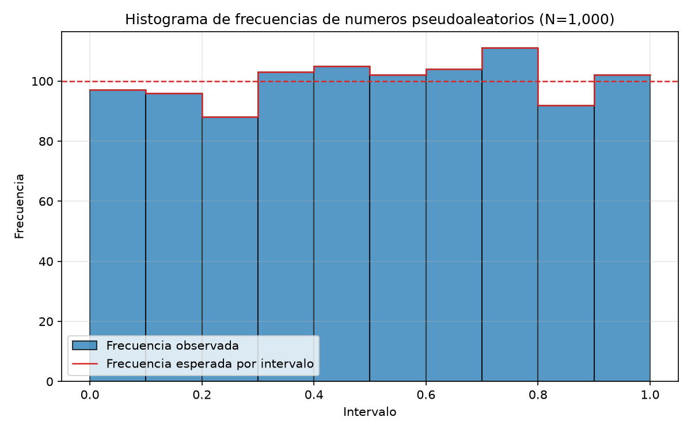
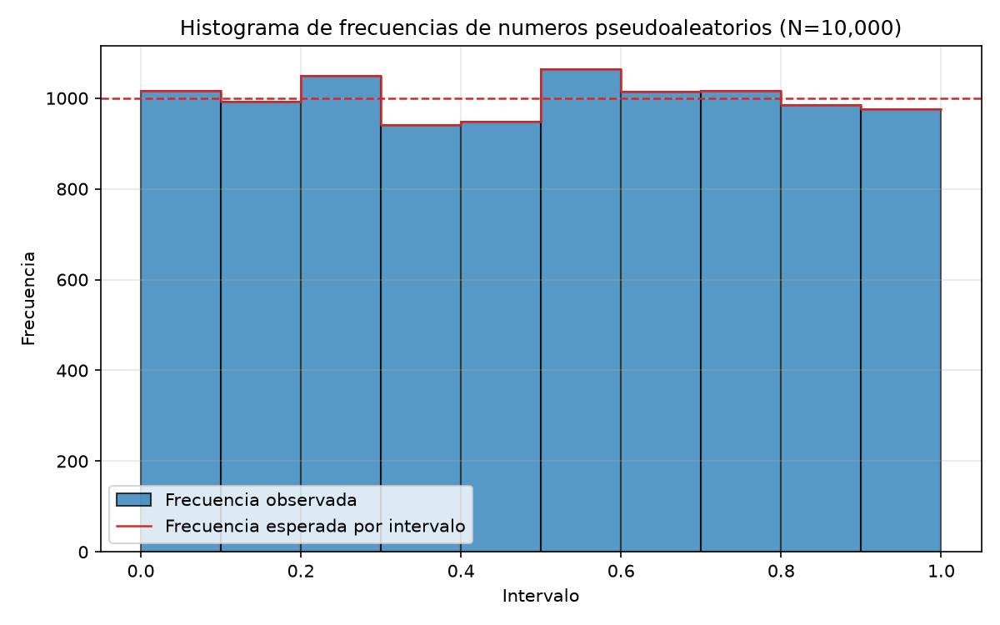
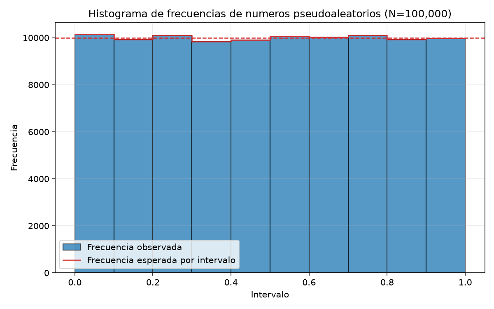
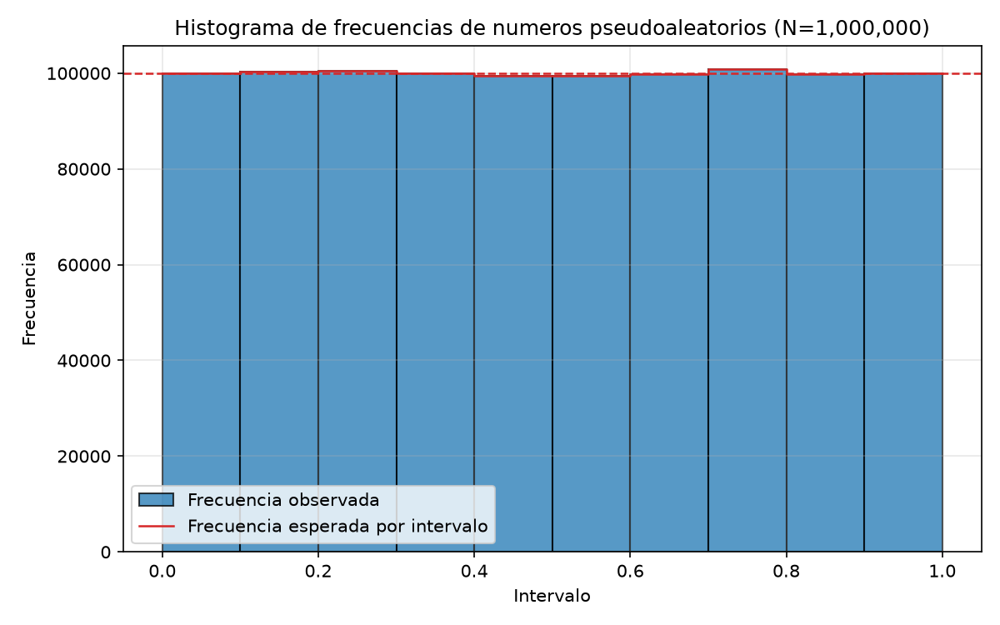
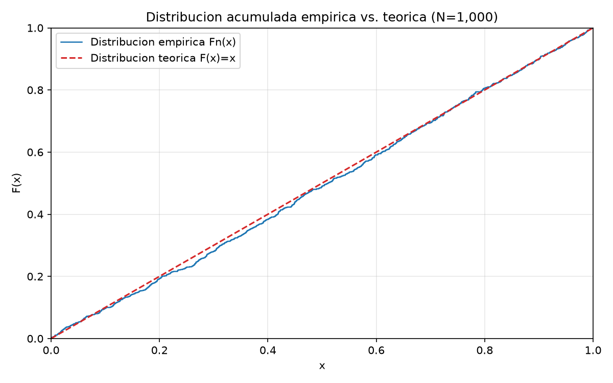
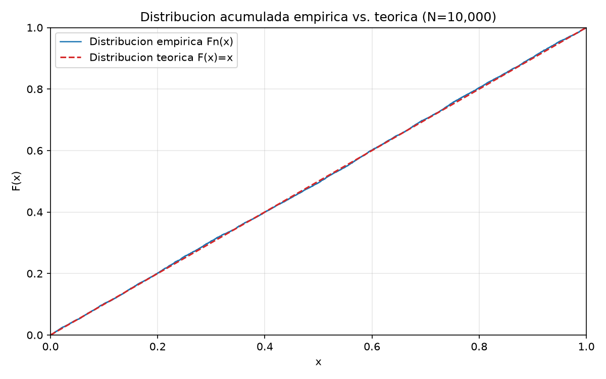
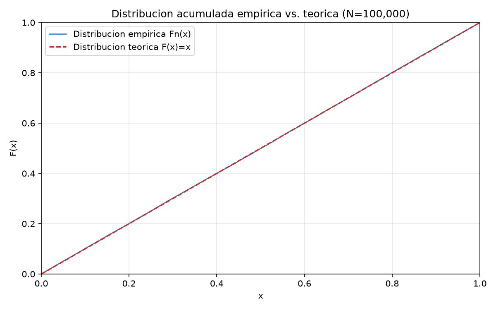
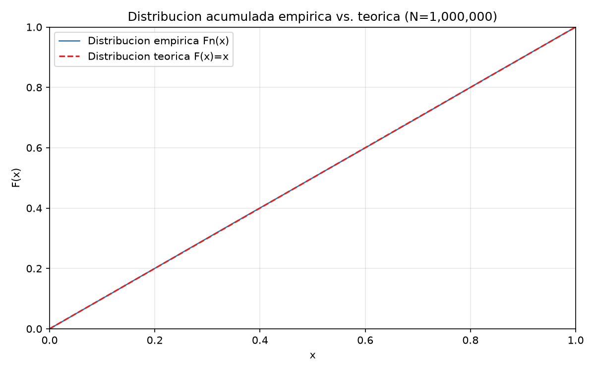
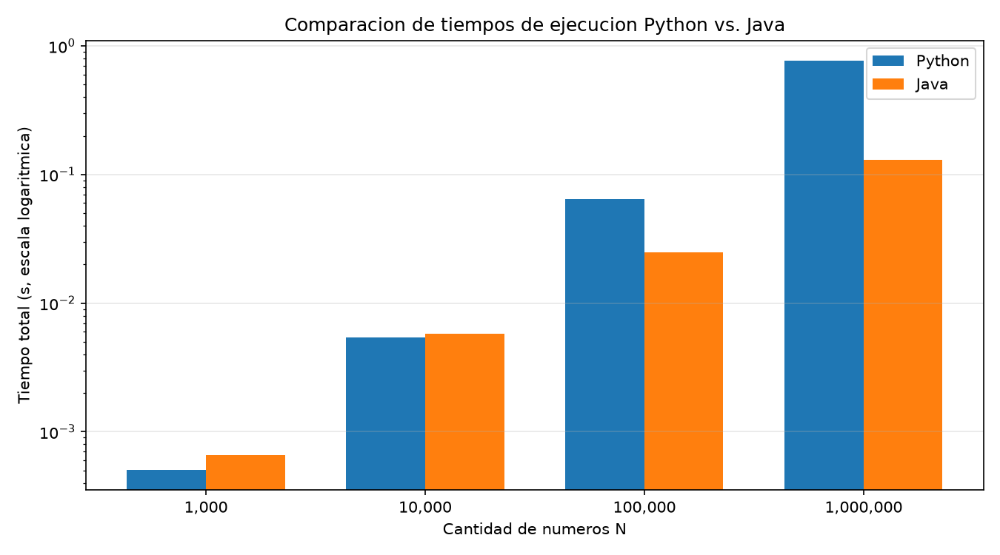
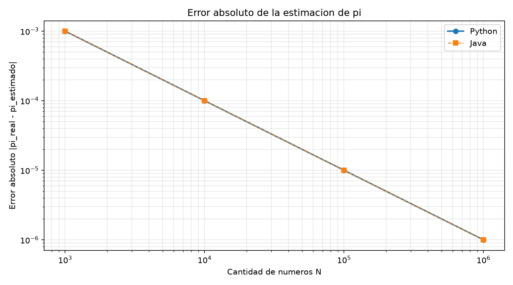

# Informe de Práctica 6 — Validación estadística de números pseudoaleatorios mediante Chi-cuadrado y Kolmogorov-Smirnov

**Asignatura:** Simulación  
**Práctica:** 6  
**Tema:** Validación estadística de un generador congruencial lineal (LCG)  
**Implementaciones:** Python 3.14 y Java 17+ (ejecutado con OpenJDK 25)  
**Nivel de significancia:** α = 0.05  
**Fecha del experimento:** 14 de noviembre de 2026

---

## 1. Resumen

Se implementó un generador congruencial lineal (LCG) en Python y Java y se
validó la uniformidad de las secuencias generadas con las pruebas de bondad de
ajuste Chi-cuadrado (χ²) y Kolmogorov-Smirnov (KS). Se procesaron muestras de
1 000, 10 000, 100 000 y 1 000 000 de números pseudoaleatorios con la semilla
base 12 345 y, adicionalmente, se repitió el experimento con las semillas 54 321
y 2 026 para evaluar la sensibilidad a la configuración inicial.

En las 12 configuraciones evaluadas (3 semillas × 4 tamaños de muestra), ninguna
prueba rechazó la hipótesis nula de uniformidad en `[0, 1]`. Los valores p
mínimos fueron 0.066409 para χ² y 0.200526 para KS, ambos superiores a
α = 0.05. Las implementaciones Python y Java produjeron secuencias de estados
idénticas y, en consecuencia, estadísticos y valores p idénticos hasta la
precisión exportada.

---

## 2. Objetivos

1. Implementar un generador congruencial lineal en Python y Java.
2. Aplicar la prueba Chi-cuadrado para evaluar la uniformidad de las
   frecuencias observadas en 10 subintervalos de `[0, 1]`.
3. Aplicar la prueba Kolmogorov-Smirnov comparando la distribución acumulada
   empírica con la distribución uniforme teórica `F(x) = x`.
4. Interpretar los estadísticos de prueba, los grados de libertad y los valores
   p obtenidos.
5. Comparar el comportamiento estadístico de diferentes configuraciones del
   generador y verificar la equivalencia entre las implementaciones Python y
   Java.

---

## 3. Marco teórico

### 3.1 Generador congruencial lineal

El LCG genera una secuencia de estados enteros mediante la recurrencia

```text
X(n+1) = (a · X(n) + c) mod m
```

y normaliza cada estado al intervalo `[0, 1)` mediante

```text
U(n) = X(n) / m
```

Los parámetros utilizados, reutilizados de la Práctica 5, son los siguientes:

| Parámetro | Símbolo | Valor |
|---|---|---|
| Semilla | `X(0)` | 12 345 |
| Multiplicador | `a` | 1 664 525 |
| Incremento | `c` | 1 013 904 223 |
| Módulo | `m` | 2³² = 4 294 967 296 |
| Nivel de significancia | `α` | 0.05 |
| Número de intervalos | `k` | 10 |

La hipótesis de trabajo es:

- **H0:** los números generados siguen una distribución uniforme `U(0, 1)`.
- **H1:** los números generados no siguen una distribución uniforme `U(0, 1)`.

### 3.2 Prueba Chi-cuadrado

El intervalo `[0, 1]` se divide en `k = 10` subintervalos de igual amplitud. El
estadístico se calcula como

```text
χ² = Σ (O_i - E_i)² / E_i,   i = 1, ..., k
```

donde `O_i` es la frecuencia observada en el intervalo `i` y
`E_i = N / k` es la frecuencia esperada. Los grados de libertad son

```text
gl = k - 1 = 10 - 1 = 9
```

Para α = 0.05, el valor crítico es `χ²(0.95, 9) = 16.919`. La hipótesis nula se
rechaza si `χ² > 16.919` o, equivalentemente, si `p < 0.05`.

### 3.3 Prueba Kolmogorov-Smirnov

La prueba compara la función de distribución acumulada empírica `Fn(x)` con la
distribución teórica `F(x) = x` de una uniforme en `[0, 1]`. El estadístico es

```text
D = sup_x |Fn(x) - F(x)|
```

En la implementación se calculan las diferencias laterales

```text
D+ = max_i [i/n - x_(i)]
D− = max_i [x_(i) - (i - 1)/n]
D  = max(D+, D−)
```

donde `x_(i)` son los datos ordenados. El valor p se obtiene con la
aproximación asintótica de Kolmogorov y la corrección de muestra finita de
Stephens:

```text
λ = (√n + 0.12 + 0.11/√n) · D
p = 2 Σ (-1)^(j-1) exp(-2 j² λ²)
```

La hipótesis nula se rechaza si `p < 0.05`.

---

## 4. Configuración y metodología

### 4.1 Configuración experimental

| Elemento | Valor |
|---|---|
| Parámetros del LCG | `a = 1 664 525`, `c = 1 013 904 223`, `m = 2³²` |
| Semilla base | 12 345 |
| Semillas adicionales | 54 321 y 2 026 |
| Tamaños de muestra | 1 000, 10 000, 100 000 y 1 000 000 |
| Subintervalos para χ² | 10 |
| Nivel de significancia | 0.05 |
| Repeticiones por configuración | Una por semilla y tamaño |

### 4.2 Implementaciones

Ambas implementaciones siguen la misma estructura lógica:

- Generación de la secuencia mediante el LCG.
- Prueba χ² con 10 intervalos y frecuencias esperadas `N/10`.
- Prueba KS con cálculo de `D+`, `D−` y `D`.
- Cálculo de los valores p sin depender de SciPy: función gamma incompleta
  regularizada para χ² y serie de Kolmogorov con corrección de Stephens para KS.
- Exportación de resultados a CSV y generación de gráficas con Matplotlib.

La implementación en Java utiliza aritmética entera de 64 bits y el operador
`%` para reducir módulo `m`; además valida que el producto `a · X + c` no
desborde el rango de `long`. Con ello reproduce exactamente la secuencia de
estados de Python. Las funciones especiales se implementaron con los mismos
algoritmos numéricos en ambos lenguajes para que los valores p coincidan.

### 4.3 Estimación de π

La guía incluye una columna de «π estimado». Esa columna no forma parte de la
validación de uniformidad y, en este proyecto, se calculó con la serie
determinista de Leibniz con `N` términos:

```text
π ≈ 4 Σ (-1)^k / (2k + 1),   k = 0, ..., N-1
```

Por ser un cálculo determinista, **el valor de π estimado no depende de la
semilla del LCG** y no debe interpretarse como una validación del generador. Se
incluye únicamente para completar la tabla solicitada por la guía (Anexo A).

---

## 5. Resultados

### 5.1 Salida de consola con la semilla base 12 345

**Python:**

```text
Resultados Python
         N      pi estimado          error     tiempo (s)       p Chi2         p KS
     1,000   3.140592653840   9.999997e-04       0.000508     0.903338     0.321240
    10,000   3.141492653590   1.000000e-04       0.005385     0.116746     0.658225
   100,000   3.141582653590   1.000000e-05       0.064173     0.422638     0.594560
 1,000,000   3.141591653590   1.000000e-06       0.766926     0.066409     0.287831
```

**Java:**

```text
Resultados Java
         N      pi estimado          error     tiempo (s)       p Chi2         p KS
      1000   3.140592653840   9.999997e-04       0.000662     0.903338     0.321240
     10000   3.141492653590   1.000000e-04       0.005775     0.116746     0.658225
    100000   3.141582653590   1.000000e-05       0.024807     0.422638     0.594560
   1000000   3.141591653590   1.000000e-06       0.130525     0.066409     0.287831
```

### 5.2 Tabla comparativa principal Python vs. Java

Los valores de χ², grados de libertad, valor p de χ², estadístico D, valor p de
KS y decisión para la semilla base son:

| N | χ² Python | gl | p(χ²) Python | D Python | p(KS) Python | Decisión Python | χ² Java | gl | p(χ²) Java | D Java | p(KS) Java | Decisión Java |
|---:|---:|---:|---:|---:|---:|---|---:|---:|---:|---:|---:|---|
| 1 000 | 4.120000 | 9 | 0.903338 | 0.028642 | 0.321240 | No se rechaza H0 | 4.120000 | 9 | 0.903338 | 0.028642 | 0.321240 | No se rechaza H0 |
| 10 000 | 14.160000 | 9 | 0.116746 | 0.005960 | 0.658225 | No se rechaza H0 | 14.160000 | 9 | 0.116746 | 0.005960 | 0.658225 | No se rechaza H0 |
| 100 000 | 9.160000 | 9 | 0.422638 | 0.002073 | 0.594560 | No se rechaza H0 | 9.160000 | 9 | 0.422638 | 0.002073 | 0.594560 | No se rechaza H0 |
| 1 000 000 | 16.022720 | 9 | 0.066409 | 0.000944 | 0.287831 | No se rechaza H0 | 16.022720 | 9 | 0.066409 | 0.000944 | 0.287831 | No se rechaza H0 |

Los valores completos, sin redondeo, están en
[`results/comparison/tabla_python_java.csv`](../results/comparison/tabla_python_java.csv).

**Lectura de la tabla.** En los cuatro tamaños de muestra el estadístico χ² es
menor que el valor crítico 16.919 y el valor p es mayor que 0.05, por lo que no
se rechaza la uniformidad. El caso más exigente es `N = 1 000 000`, con
χ² = 16.02272 y p = 0.066409: se mantiene la decisión de no rechazo, pero el
margen es menor que en los otros tamaños. La prueba KS también conduce a la
misma decisión en todos los casos.

### 5.3 Frecuencias observadas y esperadas para χ²

La siguiente tabla muestra las frecuencias observadas en cada subintervalo para
la semilla 12 345. La frecuencia esperada es `E_i = N/10` en todos los
intervalos.

| Intervalo | O (N = 1 000) | O (N = 10 000) | O (N = 100 000) | O (N = 1 000 000) |
|---|---:|---:|---:|---:|
| [0.0, 0.1) | 97 | 1 016 | 10 143 | 99 887 |
| [0.1, 0.2) | 96 | 993 | 9 928 | 100 288 |
| [0.2, 0.3) | 88 | 1 049 | 10 097 | 100 549 |
| [0.3, 0.4) | 103 | 940 | 9 835 | 99 900 |
| [0.4, 0.5) | 105 | 949 | 9 907 | 99 458 |
| [0.5, 0.6) | 102 | 1 063 | 10 061 | 99 533 |
| [0.6, 0.7) | 104 | 1 014 | 10 031 | 99 752 |
| [0.7, 0.8) | 111 | 1 016 | 10 100 | 100 764 |
| [0.8, 0.9) | 92 | 984 | 9 929 | 99 813 |
| [0.9, 1.0] | 102 | 976 | 9 969 | 100 056 |
| **Esperado `E_i`** | **100** | **1 000** | **10 000** | **100 000** |

Las diferencias entre frecuencias observadas y esperadas son pequeñas y no
muestran un patrón sistemático. En `N = 1 000` la mayor desviación absoluta es
de 12 unidades (intervalo `[0.7, 0.8)`), mientras que en `N = 1 000 000` la mayor
desviación es de 549 unidades sobre 100 000 esperadas (0.549 %).

### 5.4 Detalle de la prueba Kolmogorov-Smirnov

| N | D+ | D− | D | p(KS) | Decisión |
|---:|---:|---:|---:|---:|---|
| 1 000 | 0.010345 | 0.028642 | 0.028642 | 0.321240 | No se rechaza H0 |
| 10 000 | 0.005960 | 0.005411 | 0.005960 | 0.658225 | No se rechaza H0 |
| 100 000 | 0.002073 | 0.001742 | 0.002073 | 0.594560 | No se rechaza H0 |
| 1 000 000 | 0.000944 | 0.000739 | 0.000944 | 0.287831 | No se rechaza H0 |

El estadístico D disminuye al aumentar N, como se espera de una distribución
empírica que converge a la teórica. Este comportamiento es coherente con la
disminución del error de muestreo y respalda la hipótesis de uniformidad.

### 5.5 Resultados con varias semillas

Se repitieron las cuatro pruebas con las semillas 54 321 y 2 026. La tabla
muestra los resultados de Python; Java produjo exactamente los mismos valores.

| Semilla | N | χ² | gl | p(χ²) | D | p(KS) | Decisión |
|---:|---:|---:|---:|---:|---:|---:|---|
| 12 345 | 1 000 | 4.120000 | 9 | 0.903338 | 0.028642 | 0.321240 | No se rechaza H0 |
| 12 345 | 10 000 | 14.160000 | 9 | 0.116746 | 0.005960 | 0.658225 | No se rechaza H0 |
| 12 345 | 100 000 | 9.160000 | 9 | 0.422638 | 0.002073 | 0.594560 | No se rechaza H0 |
| 12 345 | 1 000 000 | 16.022720 | 9 | 0.066409 | 0.000944 | 0.287831 | No se rechaza H0 |
| 54 321 | 1 000 | 8.460000 | 9 | 0.488534 | 0.032994 | 0.200526 | No se rechaza H0 |
| 54 321 | 10 000 | 7.234000 | 9 | 0.612771 | 0.007481 | 0.491249 | No se rechaza H0 |
| 54 321 | 100 000 | 7.395000 | 9 | 0.596066 | 0.003121 | 0.249298 | No se rechaza H0 |
| 54 321 | 1 000 000 | 7.099800 | 9 | 0.626729 | 0.000791 | 0.445318 | No se rechaza H0 |
| 2 026 | 1 000 | 6.160000 | 9 | 0.723804 | 0.022366 | 0.534617 | No se rechaza H0 |
| 2 026 | 10 000 | 7.520000 | 9 | 0.583145 | 0.008520 | 0.378367 | No se rechaza H0 |
| 2 026 | 100 000 | 6.582600 | 9 | 0.680486 | 0.001560 | 0.761198 | No se rechaza H0 |
| 2 026 | 1 000 000 | 12.552420 | 9 | 0.183926 | 0.000961 | 0.271900 | No se rechaza H0 |

Las 12 configuraciones superaron ambas pruebas en los dos lenguajes. El valor p
más pequeño de todo el experimento fue 0.066409 (χ² con semilla 12 345 y
N = 1 000 000), todavía superior a α = 0.05. La variación de los estadísticos
entre semillas es la esperada por el muestreo y no revela un sesgo sistemático.

### 5.6 Equivalencia entre Python y Java

Para cada tamaño de muestra se compararon las secuencias de estados completas,
los valores uniformes y los resultados de ambas pruebas:

| N | ¿Estados idénticos? | máx \|U_Python − U_Java\| | \|Δp(χ²)\| | \|Δp(KS)\| | \|Δχ²\| | \|ΔD\| |
|---:|---|---:|---:|---:|---:|---:|
| 1 000 | Sí | 0.0 | 0.0 | 0.0 | 0.0 | 0.0 |
| 10 000 | Sí | 0.0 | 0.0 | 0.0 | 0.0 | 0.0 |
| 100 000 | Sí | 0.0 | 0.0 | 0.0 | 0.0 | 0.0 |
| 1 000 000 | Sí | 0.0 | 0.0 | 0.0 | 0.0 | 0.0 |

La equivalencia es exacta: ambos lenguajes generan la misma secuencia de
estados y, por tanto, los mismos números uniformes, estadísticos y valores p.

### 5.7 Tiempos de ejecución

Los tiempos corresponden a la ejecución completa (generación, χ², KS y cálculo
de π) con la semilla base:

| N | Python (s) | Java (s) | Java / Python |
|---:|---:|---:|---:|
| 1 000 | 0.000508 | 0.000662 | 1.304 |
| 10 000 | 0.005385 | 0.005775 | 1.072 |
| 100 000 | 0.064173 | 0.024807 | 0.387 |
| 1 000 000 | 0.766926 | 0.130525 | 0.170 |

En muestras pequeñas los tiempos son comparables. Para `N = 1 000 000`, Java
fue aproximadamente 5.9 veces más rápido que Python en esta ejecución. Los
tiempos dependen del entorno y deben interpretarse como una referencia, no como
una propiedad intrínseca de los lenguajes.

### 5.8 Gráficas

#### Histogramas de frecuencias

Los histogramas usan 10 intervalos y comparan la frecuencia observada con la
frecuencia esperada `N/10`.









En los cuatro casos las barras se mantienen cercanas a la línea de frecuencia
esperada. Las fluctuaciones son mayores, en términos relativos, para `N = 1 000`
y se reducen al aumentar el tamaño de muestra, lo que es consistente con la
uniformidad.

#### Distribución acumulada empírica frente a la teórica

Las siguientes gráficas comparan la ECDF de los datos generados con la recta
`F(x) = x` de la distribución uniforme teórica.









La curva empírica se aproxima a la diagonal teórica y la separación máxima
visible disminuye con N. Esta observación coincide con los valores de D de la
tabla 5.4: 0.028642 para `N = 1 000` y 0.000944 para `N = 1 000 000`.

#### Comparación de tiempos y error de π





La gráfica de tiempos usa escala logarítmica y permite ver que Java reduce
notablemente el tiempo en el tamaño mayor. La gráfica del error de π muestra la
convergencia de la serie de Leibniz; como se explicó en la sección 4.3, este
cálculo es determinista y no depende de la secuencia del LCG.

---

## 6. Discusión

1. **Uniformidad.** Todos los valores p de χ² y KS superaron α = 0.05 en las
   tres semillas y en los cuatro tamaños de muestra. No hay evidencia
   estadística suficiente para rechazar que las secuencias se distribuyan de
   forma uniforme en `[0, 1]`.
2. **Chi-cuadrado.** El estadístico máximo fue 16.02272, por debajo del valor
   crítico 16.919 para 9 grados de libertad. El valor p mínimo (0.066409) es el
   más cercano al umbral, pero conserva la decisión de no rechazo.
3. **Kolmogorov-Smirnov.** El estadístico D disminuyó al aumentar N en todas las
   semillas. Este comportamiento es el esperado cuando la ECDF converge a la
   distribución teórica y constituye una evidencia visual y numérica de
   uniformidad.
4. **Variabilidad entre semillas.** Los estadísticos cambian de una semilla a
   otra, pero las decisiones no cambian. Esto es razonable: con α = 0.05 se
   espera que, aun con un generador correcto, aproximadamente 1 de cada 20
   pruebas rechace H0 por azar. En este experimento no ocurrió ningún rechazo.
5. **Equivalencia.** La coincidencia exacta entre Python y Java valida la
   implementación del LCG y de las pruebas, y descarta diferencias por redondeo
   o por manejo de enteros.
6. **Alcance de la validación.** Que una prueba no rechace H0 no demuestra que
   el generador sea verdaderamente aleatorio. Las pruebas de bondad de ajuste
   detectan ciertos tipos de desviación, pero no sustituyen una batería completa
   de pruebas de aleatoriedad ni un análisis teórico del período.

---

## 7. Conclusiones

- El LCG con `a = 1 664 525`, `c = 1 013 904 223`, `m = 2³²` produjo secuencias
  compatibles con una distribución uniforme en `[0, 1]` para las tres semillas
  y los cuatro tamaños de muestra evaluados.
- La prueba χ² no rechazó H0 en ninguna configuración; el estadístico máximo
  fue 16.02272, inferior al valor crítico 16.919 con 9 grados de libertad.
- La prueba KS tampoco rechazó H0 en ninguna configuración; el estadístico D
  disminuyó al aumentar N, desde 0.028642 en `N = 1 000` hasta 0.000944 en
  `N = 1 000 000` para la semilla base.
- Las implementaciones Python y Java son estadísticamente equivalentes y
  producen secuencias de estados idénticas.
- El valor de π estimado con la serie de Leibniz es determinista y no depende
  de la semilla; se reporta solo para completar la tabla de la guía y no debe
  usarse como evidencia de aleatoriedad.
- Los resultados respaldan el uso del generador en simulaciones, con la
  precaución de que la validación estadística es necesaria pero no suficiente
  para garantizar un comportamiento aleatorio en todos los aspectos.

---

## 8. Preguntas de control

### 1. ¿Qué es la hipótesis nula?

La hipótesis nula (`H0`) es la afirmación que se somete a prueba y que
representa la situación «sin efecto» o «sin diferencia». En esta práctica,
`H0: X ~ U(0, 1)` establece que los números generados siguen una distribución
uniforme en el intervalo `[0, 1]`.

### 2. ¿Qué representa el valor p?

El valor p es la probabilidad de obtener un estadístico de prueba tan extremo o
más extremo que el observado, suponiendo que `H0` es verdadera. Un valor p
pequeño indica que los datos observados serían poco probables bajo la hipótesis
nula.

### 3. ¿Qué significa rechazar H0?

Rechazar `H0` significa que la evidencia muestral es suficientemente
incompatible con la hipótesis nula al nivel de significancia elegido. En esta
práctica, se rechaza `H0` cuando `p < 0.05`; en ese caso se concluye que los
números generados no se ajustan adecuadamente a una distribución uniforme.

### 4. ¿Qué diferencia existe entre Chi-cuadrado y KS?

La prueba χ² compara frecuencias observadas y esperadas en intervalos
discretos, por lo que depende de la cantidad y del ancho de los intervalos. La
prueba KS compara directamente las funciones de distribución acumuladas y
trabaja con los datos ordenados, sin agruparlos en intervalos. En general, KS
es más sensible a diferencias en la forma de la distribución y χ² es más
sensible a discrepancias en las frecuencias por intervalo.

### 5. ¿Por qué una prueba estadística no demuestra que un generador sea
verdaderamente aleatorio?

Porque una prueba de bondad de ajuste solo evalúa una propiedad concreta
(uniformidad, independencia, etc.) sobre una muestra finita. No rechazar `H0`
no prueba que el generador sea aleatorio: solo indica que no se encontró
evidencia suficiente en contra en esa muestra y con esa prueba. Un generador
determinista puede pasar varias pruebas y aun así tener patrones, correlaciones
o un período corto. Por ello se recomienda aplicar varias pruebas, analizar el
período y la reproducibilidad, y no confiar en una sola prueba.

---

## 9. Reproducibilidad

Desde la raíz de la práctica:

```bash
# Implementación Python
python python/src/main.py

# Implementación Java (clases compiladas)
java -cp java/build/classes simulation.Main

# Comparación y gráficas a partir de los CSV
python python/src/main.py --compare-only
```

Para cambiar la semilla o los tamaños de muestra se puede editar
`config/simulation.properties` o pasar un archivo de configuración alternativo:

```bash
python python/src/main.py --config ruta/a/simulation.properties
java -cp java/build/classes simulation.Main ruta/a/simulation.properties
```

Los resultados de esta práctica se generaron con la configuración descrita en
la sección 4.1. Las pruebas unitarias de Python se ejecutaron con:

```bash
python -m pytest -q python/tests
```

Resultado: **27 pruebas aprobadas**.

---

## 10. Referencias

- Guamán Q., J. O. *Guía de Actividades Práctico-Experimentales Nro. 006:
  Validación estadística de números pseudoaleatorios mediante Chi-cuadrado y
  Kolmogorov-Smirnov*. FEIRNNR, Carrera de Computación, 2026.
- Law, A. M. *Simulation Modeling and Analysis*. 5.ª ed. McGraw-Hill, 2015.
- Knuth, D. E. *The Art of Computer Programming, Vol. 2: Seminumerical
  Algorithms*. 3.ª ed. Addison-Wesley, 1997.
- Stephens, M. A. «Use of the Kolmogorov-Smirnov, Cramér-von Mises and Related
  Statistics Without Extensive Tables». *Journal of the Royal Statistical
  Society, Series B*, 32(1), 1970, pp. 115-122.
- Numerical Recipes Software. *Numerical Recipes: The Art of Scientific
  Computing*. 3.ª ed. Cambridge University Press, 2007.

---

## Anexo A. Tabla de estimación de π solicitada por la guía

Esta tabla completa la columna de «π estimado» de la guía. El valor se calculó
con la serie determinista de Leibniz y **no proviene de la secuencia del LCG**.

| N | π estimado | Error absoluto | Tiempo Python (s) | Tiempo Java (s) |
|---:|---:|---:|---:|---:|
| 1 000 | 3.140592653840 | 9.999997e-04 | 0.000508 | 0.000662 |
| 10 000 | 3.141492653590 | 1.000000e-04 | 0.005385 | 0.005775 |
| 100 000 | 3.141582653590 | 1.000000e-05 | 0.064173 | 0.024807 |
| 1 000 000 | 3.141591653590 | 1.000000e-06 | 0.766926 | 0.130525 |

El error absoluto disminuye aproximadamente como `1/N`, comportamiento propio
de la serie alterna de Leibniz. Para obtener una estimación de π ligada al
generador habría que usar un método Monte Carlo, por ejemplo estimar el área
del círculo unitario con pares de números uniformes; ese experimento es
diferente del objetivo de esta práctica y no se incluye aquí.

---

## Anexo B. Archivos de resultados generados

| Archivo | Contenido |
|---|---|
| [`results/comparison/tabla_python_java.csv`](../results/comparison/tabla_python_java.csv) | Tabla comparativa Python vs. Java con χ², gl, p(χ²), D, p(KS), decisión y verificación de equivalencia |
| [`results/comparison/tabla_por_lenguaje.csv`](../results/comparison/tabla_por_lenguaje.csv) | Resultados en formato largo por semilla, lenguaje y tamaño |
| [`results/comparison/tabla_semillas.csv`](../results/comparison/tabla_semillas.csv) | Resumen de las tres semillas con χ², p(χ²), D, p(KS) y decisión |
| [`results/comparison/comparison.csv`](../results/comparison/comparison.csv) | Comparación completa generada por el programa, con diferencias numéricas |
| [`results/comparison/pi_table.csv`](../results/comparison/pi_table.csv) | Tabla de π estimado, error y tiempos |
| [`python/results/statistics/chi_square.csv`](../python/results/statistics/chi_square.csv) | Frecuencias observadas y esperadas, χ², gl y p de Python |
| [`python/results/statistics/kolmogorov_smirnov.csv`](../python/results/statistics/kolmogorov_smirnov.csv) | D+, D−, D, p y decisión de Python |
| [`java/results/statistics/chi_square.csv`](../java/results/statistics/chi_square.csv) | Frecuencias observadas y esperadas, χ², gl y p de Java |
| [`java/results/statistics/kolmogorov_smirnov.csv`](../java/results/statistics/kolmogorov_smirnov.csv) | D+, D−, D, p y decisión de Java |
| [`results/plots/`](../results/plots/) | Histogramas, ECDF, comparación de tiempos y error de π |
