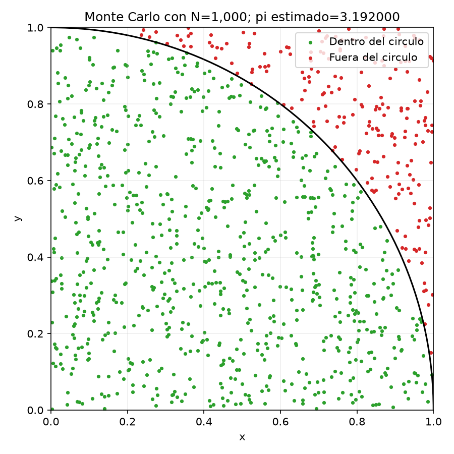
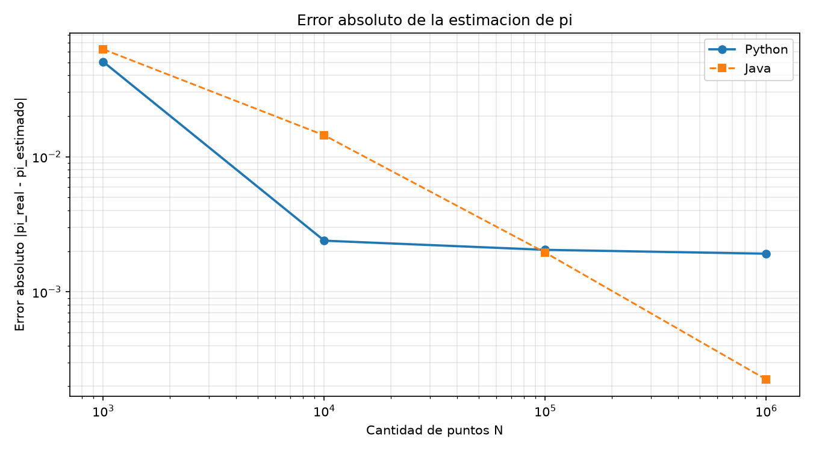
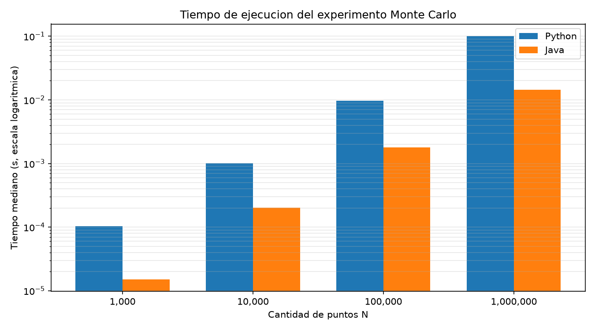

# Universidad Nacional de Loja

## Facultad de la Energía, las Industrias y los Recursos Naturales No Renovables

### Carrera de Computación

**Asignatura:** Simulación  
**Práctica Nro.:** 07  
**Título:** Estimación de resultados mediante el método de Monte Carlo  
**Estudiante:** Emilio Jose Galvez Merchan  
**Docente:** José O. Guamán Q.  
**Ciclo:** 5  
**Fecha del experimento:** 15 de noviembre de 2026  
**Implementaciones:** Python 3.14.4 y Java 17+ (OpenJDK 25.0.4.1)

---

## 1. Resumen

Se implementó el método de Monte Carlo en Python y Java para estimar π con
1 000, 10 000, 100 000 y 1 000 000 de puntos. Para cada `N` se generaron puntos
uniformes en `[0, 1) × [0, 1)` y se contaron los que cayeron dentro del círculo
unitario; la estimación se obtuvo con `π ≈ 4·(Nc/N)`. El error se calculó como
`|π_real − π_estimado|`, con `π_real = 3.141592653589793`.

Ambas implementaciones usaron su RNG nativo con la misma semilla (`12345`).
Los tiempos reportados son la mediana de cinco repeticiones y miden únicamente
el ciclo Monte Carlo. En esta ejecución, Java fue más rápido en los cuatro
tamaños de muestra: para `N = 1 000 000`, Python tardó 0.100435 s y Java
0.014497 s, una razón aproximada de 6.93 a 1. La mejor aproximación se obtuvo
en Java con `N = 1 000 000`: `π ≈ 3.141368`, error `2.246536×10⁻⁴`. Python
también mejoró al aumentar `N`, con un error de `1.916654×10⁻³` para
`N = 1 000 000`.

El experimento confirma la tendencia esperada de reducción del error al
aumentar el tamaño de muestra, aunque la mejora no es estrictamente
proporcional a `N` ni está garantizada en cada ejecución individual. Las
diferencias entre las estimaciones de Python y Java se explican porque sus
generadores pseudoaleatorios nativos son distintos, aunque compartan la semilla.

---

## 2. Objetivos

### 2.1 Objetivo general

Aplicar el método de Monte Carlo para obtener una aproximación numérica de π,
implementar el experimento en Python y Java, y analizar la influencia del tamaño
de muestra sobre el error y el costo computacional.

### 2.2 Objetivos específicos

1. Implementar el experimento Monte Carlo con el procedimiento indicado en la
   guía: `π ≈ 4·(Nc/N)`.
2. Ejecutar el experimento con `N = 1 000`, `10 000`, `100 000` y `1 000 000`
   de puntos en Python y Java.
3. Calcular el error absoluto respecto de `π_real = 3.141592653589793`.
4. Medir y comparar los tiempos de ejecución de ambas implementaciones.
5. Analizar la relación entre el tamaño de muestra, el error y el tiempo de
   ejecución.
6. Documentar los resultados, las conclusiones y los supuestos del experimento.

---

## 3. Marco teórico

### 3.1 Método Monte Carlo

El método Monte Carlo es una familia de técnicas numéricas que utilizan
muestreo aleatorio para estimar cantidades difíciles de calcular de forma
analítica, como integrales, áreas, probabilidades o valores esperados. Su
nombre proviene del casino de Mónaco y su desarrollo moderno se asocia a
Metropolis y Ulam [2]. En su forma más simple, se genera una muestra aleatoria
de una distribución conocida, se evalúa una función sobre la muestra y se
promedian los resultados.

La precisión del método depende del tamaño de la muestra y de la calidad del
generador de números pseudoaleatorios. La convergencia es probabilística: el
error tiende a disminuir al aumentar `N`, pero no necesariamente de forma
monótona en una ejecución particular [3].

### 3.2 Estimación de π

Se considera el cuadrado unitario `[0, 1) × [0, 1)` y el cuarto de círculo de
radio 1 centrado en el origen:

```text
x² + y² ≤ 1,   x ≥ 0,   y ≥ 0
```

El área del cuadrado es 1 y el área del cuarto de círculo es `π/4`. Si se
generan `N` puntos uniformes en el cuadrado y `Nc` caen dentro del cuarto de
círculo, la proporción muestral estima la proporción de áreas:

```text
Nc / N ≈ (π/4) / 1 = π/4
```

Por tanto:

```text
π_estimado = 4 · (Nc / N)
```

Este es exactamente el procedimiento solicitado en la guía de la práctica [1].

### 3.3 Error absoluto y convergencia

El error absoluto se define como:

```text
Error = |π_real − π_estimado|
```

con `π_real = 3.141592653589793`.

Si `Nc ∼ Binomial(N, p)` con `p = π/4`, entonces el estimador
`π_estimado = 4·Nc/N` es insesgado:

```text
E[π_estimado] = π
```

y su varianza es:

```text
Var(π_estimado) = π(4 − π) / N
```

Por tanto, la desviación estándar del estimador disminuye como `1/√N`:

```text
σ(π_estimado) = √(π(4 − π) / N)
```

Esto implica que, para reducir el error a la mitad, se necesita aproximadamente
cuatro veces más puntos. La convergencia es en probabilidad, no una garantía de
que cada ejecución con mayor `N` produzca un error menor que la anterior.

### 3.4 Generación de números pseudoaleatorios

Monte Carlo requiere números que se comporten como muestras independientes de
una distribución uniforme. En la práctica se usan generadores
pseudoaleatorios deterministas, que producen una secuencia reproducible a
partir de una semilla [4].

Python utiliza el generador Mersenne Twister en `random.Random` [5], mientras
que Java utiliza un generador congruencial lineal de 48 bits en
`java.util.Random` [6]. Ambos aceptan una semilla, pero **la misma semilla no
produce la misma secuencia en los dos lenguajes**, porque los algoritmos son
diferentes. Esta es la razón principal de que las estimaciones de π no coincidan
exactamente entre Python y Java.

La calidad del generador es importante: un generador con sesgo, correlaciones o
un período corto puede producir estimaciones incorrectas aunque se aumente `N`.
La reproducibilidad mediante la semilla permite repetir el experimento y
auditar los resultados.

---

## 4. Metodología y configuración

### 4.1 Configuración experimental

| Elemento | Valor |
|---|---|
| Método | Monte Carlo |
| Fórmula | `π ≈ 4·(Nc/N)` |
| Tamaños de muestra | 1 000, 10 000, 100 000 y 1 000 000 de puntos |
| Semilla | 12 345 |
| RNG Python | `random.Random(12345)` (Mersenne Twister) |
| RNG Java | `java.util.Random(12345)` (congruencial lineal de 48 bits) |
| Repeticiones por `N` | 5 |
| Calentamiento | 1 000 000 de puntos, no medido |
| Tiempo reportado | Mediana de las 5 repeticiones |
| Valor de referencia | `π_real = 3.141592653589793` |
| Error | `|π_real − π_estimado|` |

### 4.2 Procedimiento

Para cada valor de `N`:

1. Se crea un RNG nuevo con la semilla 12 345.
2. Se generan `N` pares `(x, y)` con `x, y ∈ [0, 1)`.
3. Se cuenta `Nc`, la cantidad de pares que cumplen `x² + y² ≤ 1`.
4. Se calcula `π_estimado = 4·Nc/N`.
5. Se calcula el error absoluto respecto de `π_real`.
6. Se repite el ciclo 5 veces con la misma semilla para medir el tiempo.
7. Se reporta la mediana de los 5 tiempos y la estimación obtenida.

Como cada `N` reinicia el RNG con la misma semilla, la muestra de `N = 10 000`
contiene los primeros 1 000 puntos de `N = 1 000`. Esto permite observar cómo
se estabiliza la estimación al agregar puntos, aunque las muestras de distinto
`N` no son independientes entre sí.

### 4.3 Implementaciones

**Python.** El experimento está en
`python/src/simulation/monte_carlo_pi.py`. Usa `random.Random(seed)` y
`time.perf_counter_ns()` para medir el ciclo. La exportación de resultados se
realiza con Pandas y las gráficas con Matplotlib.

**Java.** El experimento está en
`java/src/main/java/simulation/simulation/MonteCarloPi.java`. Usa
`java.util.Random(seed)` y `System.nanoTime()` para medir el ciclo. La
exportación CSV se implementa con `BufferedWriter`.

Ambas implementaciones siguen la misma secuencia lógica: creación del RNG,
generación de pares, conteo de puntos dentro del círculo, cálculo de la
estimación, cálculo del error y repetición para medir tiempos.

### 4.4 Medición de tiempos

Se midió únicamente el ciclo Monte Carlo: generación de los `N` pares y conteo
de puntos dentro del círculo. No se incluyeron:

- el arranque del intérprete de Python;
- el arranque de la JVM;
- la compilación del código Java;
- la lectura de la configuración;
- la exportación a CSV;
- la generación de gráficas.

Antes de las mediciones se ejecutó una muestra de calentamiento de 1 000 000 de
puntos para reducir el efecto del arranque y permitir que la JVM compilara el
bucle. Para cada `N` se realizaron 5 repeticiones y se reportó la mediana, que
es menos sensible a valores atípicos que el promedio.

El equipo utilizado fue un AMD Ryzen 7 7435HS (16 hilos), con 14 GiB de RAM y
Linux 7.0.0-38-generic. Los tiempos dependen del hardware, del sistema
operativo y de la carga del equipo; por tanto, deben interpretarse como una
referencia de esta ejecución, no como una propiedad universal de los lenguajes.

### 4.5 Reproducibilidad y pruebas

La configuración compartida está en `config/simulation.properties`. Las pruebas
unitarias de Python verifican la fórmula, el cálculo del error, la
reproducibilidad con la misma semilla y el rechazo de valores inválidos. Se
ejecutaron con:

```bash
python -m pytest -q python/tests
```

Resultado: **6 pruebas aprobadas**.

Los comandos completos de reproducción se incluyen en el Anexo B.

---

## 5. Resultados

### 5.1 Tabla solicitada por la guía

La guía pide las columnas `N`, `π estimado`, `Error`, `Tiempo Python` y
`Tiempo Java`. Como se usó un RNG nativo distinto en cada lenguaje, Java produce
su propia estimación. Para la tabla solicitada se usa la estimación de Python
como referencia; la estimación independiente de Java se presenta en la
sección 5.2.

| N | π estimado | Error | Tiempo Python (s) | Tiempo Java (s) |
|---:|---:|---:|---:|---:|
| 1 000 | 3.192000000000 | 5.040735e-02 | 0.000104 | 0.000015 |
| 10 000 | 3.139200000000 | 2.392654e-03 | 0.001011 | 0.000202 |
| 100 000 | 3.143640000000 | 2.047346e-03 | 0.009696 | 0.001777 |
| 1 000 000 | 3.139676000000 | 1.916654e-03 | 0.100435 | 0.014497 |

Los valores completos, sin redondeo, están en
[`results/comparison/tabla_solicitada.csv`](../results/comparison/tabla_solicitada.csv).

### 5.2 Estimaciones por lenguaje

| N | π Python | Error Python | π Java | Error Java |
|---:|---:|---:|---:|---:|
| 1 000 | 3.192000000000 | 5.040735e-02 | 3.204000000000 | 6.240735e-02 |
| 10 000 | 3.139200000000 | 2.392654e-03 | 3.156000000000 | 1.440735e-02 |
| 100 000 | 3.143640000000 | 2.047346e-03 | 3.139640000000 | 1.952654e-03 |
| 1 000 000 | 3.139676000000 | 1.916654e-03 | 3.141368000000 | 2.246536e-04 |

La mejor estimación global de esta ejecución fue la de Java con
`N = 1 000 000`: `π ≈ 3.141368`, con error `2.246536×10⁻⁴`. En Python, la
mejor estimación también correspondió a `N = 1 000 000`, con
`π ≈ 3.139676` y error `1.916654×10⁻³`.

### 5.3 Tiempos de ejecución

| N | Python (s) | Java (s) | Java / Python | Python / Java |
|---:|---:|---:|---:|---:|
| 1 000 | 0.000104 | 0.000015 | 0.145 | 6.88 |
| 10 000 | 0.001011 | 0.000202 | 0.200 | 5.01 |
| 100 000 | 0.009696 | 0.001777 | 0.183 | 5.46 |
| 1 000 000 | 0.100435 | 0.014497 | 0.144 | 6.93 |

Java fue más rápido en los cuatro tamaños de muestra. La ventaja fue de
aproximadamente 5 a 7 veces en esta ejecución. Para `N = 1 000 000`, Python
tardó 0.100435 s y Java 0.014497 s.

### 5.4 Comparación con el error esperado

Como referencia teórica, la desviación estándar del estimador es
`σ = √(π(4−π)/N)`. El error absoluto medio esperado bajo una aproximación
normal es `σ·√(2/π)`. La siguiente tabla compara esos valores teóricos con los
errores observados.

| N | σ teórica de π_estimado | Error absoluto medio esperado | Error Python | Error Java |
|---:|---:|---:|---:|---:|
| 1 000 | 0.051930 | 0.041434 | 0.050407 | 0.062407 |
| 10 000 | 0.016422 | 0.013103 | 0.002393 | 0.014407 |
| 100 000 | 0.005193 | 0.004143 | 0.002047 | 0.001953 |
| 1 000 000 | 0.001642 | 0.001310 | 0.001917 | 0.000225 |

Los errores observados son del mismo orden de magnitud que la referencia
teórica. Las diferencias entre filas son el resultado del muestreo aleatorio:
por ejemplo, el error de Python para `N = 10 000` fue menor que el valor medio
esperado, mientras que el de Java fue cercano a ese valor. En `N = 1 000 000`,
el error de Python (0.001917) está ligeramente por encima de `σ` (0.001642),
mientras que el de Java (0.000225) quedó muy por debajo. Ambos casos son
compatibles con la variabilidad propia del método.

### 5.5 Gráficas

#### Puntos generados para N = 1 000



La gráfica muestra los puntos dentro del círculo (verde) y fuera de él (rojo)
para `N = 1 000`. La estimación de Python para esta muestra fue
`π ≈ 3.192`, con un error de `5.040735×10⁻²`.

#### Error absoluto en función de N



El error disminuye al aumentar `N`, aunque la pendiente no es constante. La
gráfica usa escala logarítmica en ambos ejes para visualizar el orden de
magnitud.

#### Tiempos de ejecución en función de N



Los tiempos crecen con `N` y Java se mantiene por debajo de Python en todos los
tamaños. La escala vertical es logarítmica.

---

## 6. Análisis de resultados

### 6.1 ¿Cómo cambia la estimación de π cuando aumenta el número de puntos?

En esta ejecución, ambas implementaciones se acercaron a `π_real` al aumentar
`N`. Python pasó de `3.192000` con `N = 1 000` a `3.139676` con
`N = 1 000 000`. Java pasó de `3.204000` a `3.141368`. La mejora fue clara
entre `N = 1 000` y `N = 10 000`, y más moderada en los tamaños siguientes.

Sin embargo, la mejora no es proporcional a `N` ni tiene por qué ser monótona
en todas las ejecuciones. Por ejemplo, el error de Python bajó de
`5.040735×10⁻²` a `2.392654×10⁻³` al pasar de 1 000 a 10 000 puntos, pero de
10 000 a 100 000 solo bajó a `2.047346×10⁻³`. Esa variación es normal: el error
depende de la muestra aleatoria concreta.

### 6.2 ¿Qué relación existe entre el tamaño de muestra y el error absoluto?

La relación esperada es inversa y no lineal: la desviación estándar del
estimador es proporcional a `1/√N`. Para reducir el error a la mitad se
necesitan aproximadamente cuatro veces más puntos. Los resultados son
coherentes con esa escala: los errores de `N = 1 000` son del orden de `10⁻²`,
los de `N = 10 000` del orden de `10⁻²` a `10⁻³`, los de `N = 100 000` del
orden de `10⁻³` y los de `N = 1 000 000` del orden de `10⁻³` a `10⁻⁴`.

La relación es probabilística, no determinista. Un aumento de `N` reduce el
error esperado, pero no garantiza que una ejecución concreta tenga un error
menor que otra con menos puntos.

### 6.3 ¿En cuál de los tamaños de muestra se obtuvo una mejor aproximación de π?

La mejor aproximación global se obtuvo con `N = 1 000 000` en Java:
`π ≈ 3.141368`, error `2.246536×10⁻⁴`. En Python, el mejor resultado también
fue con `N = 1 000 000`: `π ≈ 3.139676`, error `1.916654×10⁻³`.

El peor resultado se obtuvo con `N = 1 000`: Python `3.192000` (error
`5.040735×10⁻²`) y Java `3.204000` (error `6.240735×10⁻²`). Esto es coherente
con el menor tamaño de muestra.

### 6.4 ¿Qué lenguaje presentó menor tiempo de ejecución?

Java presentó menor tiempo de ejecución en los cuatro tamaños de muestra. Las
razones `Java/Python` fueron 0.145, 0.200, 0.183 y 0.144 para 1 000, 10 000,
100 000 y 1 000 000 de puntos, respectivamente. En términos de `Python/Java`,
Java fue entre 5.01 y 6.93 veces más rápido en esta ejecución.

Para `N = 1 000 000`, Python tardó 0.100435 s y Java 0.014497 s. Esta diferencia
se explica principalmente porque Java es compilado y la JVM aplica
optimizaciones en tiempo de ejecución, mientras que Python interpreta el bucle
y tiene mayor sobrecarga por operación.

### 6.5 ¿Por qué los resultados obtenidos en Python y Java pueden ser diferentes?

La causa principal es que cada lenguaje usa un generador pseudoaleatorio nativo
distinto. Python usa Mersenne Twister en `random.Random` y Java usa un
generador congruencial lineal de 48 bits en `java.util.Random`. Aunque ambos
reciban la semilla 12 345, las secuencias generadas no son iguales.

Como Monte Carlo depende de los puntos generados, secuencias distintas producen
distinto `Nc` y, por tanto, distintas estimaciones de π. También pueden existir
diferencias menores por el orden de las operaciones y el redondeo de punto
flotante, pero la diferencia dominante es el generador.

Si se necesitara que ambos lenguajes produjeran exactamente la misma secuencia,
habría que implementar el mismo generador en los dos, por ejemplo un LCG con
parámetros idénticos. Esa no fue la opción elegida en este experimento.

### 6.6 ¿Qué importancia tiene la generación de números pseudoaleatorios en el método Monte Carlo?

Es fundamental. El generador proporciona las muestras que alimentan todo el
experimento. Si los números no son aproximadamente uniformes e independientes,
la proporción `Nc/N` no estima correctamente el área y la estimación de π queda
sesgada. Un generador con correlaciones, patrones o período corto puede producir
errores difíciles de detectar solo con aumentar `N`.

Además, la semilla permite reproducir el experimento y comparar resultados. En
esta práctica, la misma semilla en el mismo lenguaje produce la misma
estimación, lo que facilita la verificación.

### 6.7 ¿El aumento del número de puntos garantiza que cada ejecución obtenga un resultado más cercano al valor real?

No. El aumento de `N` reduce la varianza del estimador y, por la ley de los
grandes números, la estimación converge a π. Sin embargo, la convergencia es
probabilística: una ejecución concreta con más puntos puede, por azar, quedar
más lejos que una con menos puntos.

En esta ejecución ambos lenguajes mejoraron al aumentar `N`, pero eso no es una
garantía general. La afirmación correcta es que el error esperado disminuye con
`N`, no que cada ejecución individual mejore necesariamente.

### 6.8 ¿Qué aplicaciones reales puede tener el método Monte Carlo en ingeniería, economía, informática y ciencias?

- **Ingeniería:** análisis de confiabilidad, tolerancias, riesgo, transporte de
  partículas, simulación de sistemas de colas y evaluación de diseños bajo
  incertidumbre.
- **Economía y finanzas:** valoración de opciones, estimación de riesgo de
  cartera (por ejemplo, VaR), análisis de escenarios y proyecciones bajo
  incertidumbre.
- **Informática:** renderizado realista y iluminación global, integración
  numérica en alta dimensión, inferencia bayesiana, aprendizaje automático y
  algoritmos aleatorizados.
- **Ciencias:** simulación de sistemas físicos, mecánica estadística,
  simulación de detectores, química computacional, epidemiología, biología de
  poblaciones y modelación climática.

---

## 7. Preguntas de control

### 7.1 ¿Qué es Monte Carlo?

Es una familia de métodos numéricos que usan muestreo aleatorio para estimar
cantidades como integrales, áreas, probabilidades o valores esperados, o para
simular sistemas con incertidumbre. En esta práctica se usa para estimar el
área del cuarto de círculo unitario y, a partir de ella, π.

### 7.2 ¿Por qué el error disminuye al aumentar las muestras?

Porque el estimador es un promedio de muchas observaciones. La varianza de la
proporción muestral disminuye como `1/N`, de modo que la desviación estándar
disminuye como `1/√N`. Al promediar más observaciones, las fluctuaciones
aleatorias se compensan y la estimación tiende a estabilizarse alrededor del
valor esperado.

### 7.3 ¿Qué relación existe entre precisión y costo computacional?

El costo computacional crece aproximadamente de forma lineal con `N`, mientras
que el error disminuye como `1/√N`. Por tanto, mejorar la precisión tiene un
costo creciente: para reducir el error a la mitad se necesitan alrededor de
cuatro veces más puntos. Existe un compromiso entre precisión y tiempo de
cómputo.

### 7.4 ¿Qué diferencias se observaron entre Python y Java?

Java fue más rápido en todos los tamaños de muestra, con una ventaja de
aproximadamente 5 a 7 veces en esta ejecución. Las estimaciones de π fueron
distintas porque los RNG nativos son diferentes, aunque ambos usaron la misma
semilla. En esta corrida, Python tuvo mejor error para `N = 1 000` y
`N = 10 000`, mientras que Java tuvo mejor error para `N = 100 000` y
`N = 1 000 000`. Esas diferencias son muestrales y no demuestran que un lenguaje
sea intrínsecamente más preciso.

### 7.5 ¿En qué otros problemas puede utilizarse Monte Carlo?

En integración numérica, optimización, análisis de riesgo, confiabilidad,
valoración de opciones, simulación de colas, renderizado, transporte de
partículas, inferencia bayesiana, física estadística, epidemiología y, en
general, en problemas donde se necesita estimar una cantidad o explorar un
espacio de estados con alta dimensionalidad o incertidumbre.

---

## 8. Conclusiones

- Se implementó correctamente el método Monte Carlo para estimar π en Python y
  Java, con el mismo procedimiento `π ≈ 4·(Nc/N)` y los cuatro tamaños de
  muestra solicitados por la guía.
- Las estimaciones se acercaron a `π_real` al aumentar `N`. La mejor
  aproximación global se obtuvo en Java con `N = 1 000 000`:
  `π ≈ 3.141368`, error `2.246536×10⁻⁴`.
- El error no disminuyó de forma exactamente proporcional a `N`; su
  comportamiento es coherente con una desviación estándar proporcional a
  `1/√N`, y puede variar entre ejecuciones por el muestreo aleatorio.
- Java fue más rápido que Python en los cuatro tamaños de muestra. Para
  `N = 1 000 000`, Java fue aproximadamente 6.93 veces más rápido en esta
  ejecución.
- Las diferencias entre las estimaciones de Python y Java se explican
  principalmente por el uso de RNG nativos distintos. La misma semilla no
  garantiza la misma secuencia entre lenguajes.
- La comparación entre Python y Java es válida en cuanto al procedimiento,
  tamaños de muestra, semilla y método de medición, pero no en cuanto a
  secuencias idénticas. Si se requiere equivalencia exacta, debe implementarse
  el mismo generador en ambos lenguajes.
- Los resultados obtenidos son reales y quedaron registrados en los archivos
  CSV y gráficas del proyecto; no se inventaron valores.

---

## 9. Supuestos y ambigüedades

1. **La guía exige Monte Carlo.** La guía de la Práctica 7 especifica el
   procedimiento `π ≈ 4·(Nc/N)`. Se implementó ese método después de la
   confirmación del usuario.
2. **RNG nativo con la misma semilla.** La guía espera que ambas
   implementaciones produzcan la misma secuencia con los mismos parámetros. En
   este proyecto se usó el RNG nativo de cada lenguaje, como se solicitó.
   Python y Java usan algoritmos distintos, por lo que las secuencias y las
   estimaciones no son idénticas. La comparación es válida en procedimiento,
   `N`, semilla y medición de tiempos, no en igualdad de secuencias.
3. **Medición de tiempos.** Se mide solo el ciclo Monte Carlo. Se excluyen el
   arranque de Python, el arranque de la JVM, la compilación, la exportación CSV
   y las gráficas. Se reporta la mediana de 5 repeticiones después de un
   calentamiento de 1 000 000 de puntos. Los tiempos dependen del equipo.
4. **Muestras anidadas.** Cada `N` reinicia el RNG con la misma semilla, por lo
   que `N = 10 000` contiene los primeros 1 000 puntos de `N = 1 000`. Esto es
   útil para estudiar convergencia, pero las muestras de distinto `N` no son
   independientes.
5. **`N` representa puntos.** Cada punto consume dos valores uniformes (`x`,
   `y`). La guía habla de «puntos» y así se interpretó.
6. **Error absoluto.** Se usó exactamente `|π_real − π_estimado|` con
   `π_real = 3.141592653589793`, según la instrucción del usuario.
7. **Referencia de la guía.** La sección de evaluación de la guía menciona
   «modelo M/M/1» por un error de copia; esa parte no corresponde al objetivo de
   esta práctica y no se implementó.
8. **Una sola semilla.** El experimento se realizó con la semilla 12 345. No se
   evaluó la variabilidad entre semillas ni se construyeron intervalos de
   confianza; esos análisis podrían añadirse en una ampliación del estudio.

---

## 10. Referencias

1. Guamán Q., J. O. *Guía de Actividades Práctico-Experimentales Nro. 007:
   Estimación de resultados mediante el método de Monte Carlo*. FEIRNNR,
   Carrera de Computación, Universidad Nacional de Loja, 2026.
2. Metropolis, N., y Ulam, S. «The Monte Carlo Method». *Journal of the
   American Statistical Association*, 44(247), 1949, pp. 335-341.
3. Law, A. M. *Simulation Modeling and Analysis*. 5.ª ed. McGraw-Hill, 2015.
4. Knuth, D. E. *The Art of Computer Programming, Vol. 2: Seminumerical
   Algorithms*. 3.ª ed. Addison-Wesley, 1997.
5. Python Software Foundation. *random — Generate pseudo-random numbers*.
   Documentación de Python 3.14.
6. Oracle. *Java Platform, Standard Edition 17 API Specification:
   java.util.Random*. Documentación de Java 17.
7. Ross, S. M. *Simulation*. 5.ª ed. Academic Press, 2013.

---

## Anexo A. Archivos de resultados generados

| Archivo | Contenido |
|---|---|
| [`results/python/mediciones.csv`](../results/python/mediciones.csv) | Las 5 mediciones por cada `N` en Python |
| [`results/python/resumen.csv`](../results/python/resumen.csv) | Resumen de Python: `Nc`, π estimado, error y tiempos |
| [`results/java/mediciones.csv`](../results/java/mediciones.csv) | Las 5 mediciones por cada `N` en Java |
| [`results/java/resumen.csv`](../results/java/resumen.csv) | Resumen de Java: `Nc`, π estimado, error y tiempos |
| [`results/comparison/tabla_comparativa.csv`](../results/comparison/tabla_comparativa.csv) | Comparación completa Python vs. Java |
| [`results/comparison/tabla_solicitada.csv`](../results/comparison/tabla_solicitada.csv) | Tabla con el formato solicitado por la guía |
| [`results/comparison/tabla_comparativa.md`](../results/comparison/tabla_comparativa.md) | Tabla comparativa en Markdown |
| [`results/plots/`](../results/plots/) | Gráficas de puntos, error y tiempos |

---

## Anexo B. Comandos de reproducción

Desde la raíz del repositorio:

```bash
cd ~/simulacion
source venv/bin/activate
pip install -r Unidad2/practica7/requirements.txt
cd Unidad2/practica7

# 1. Ejecutar Python
python python/src/main.py --no-compare

# 2. Compilar y ejecutar Java
cd java
mkdir -p build/classes
javac -encoding UTF-8 -d build/classes $(find src/main/java -name "*.java")
java -cp build/classes simulation.Main
cd ..

# 3. Comparar, generar la tabla y las gráficas
python python/src/main.py --compare-only

# 4. Ejecutar las pruebas de Python
python -m pytest -q python/tests
```

Para cambiar los tamaños de muestra o el número de repeticiones sin editar el
archivo de configuración:

```bash
python python/src/main.py --sizes 1000,10000 --repetitions 3 --no-compare
```
