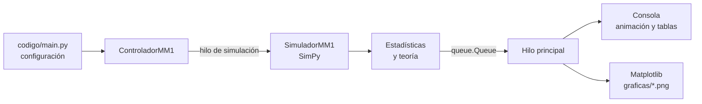
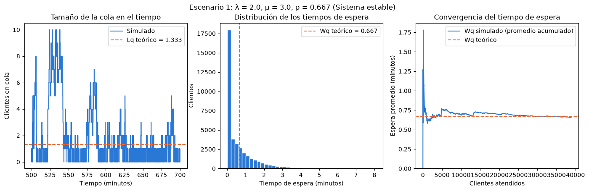
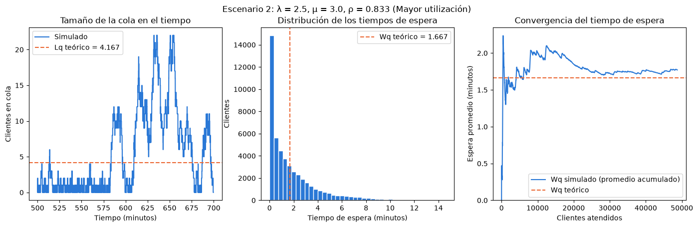
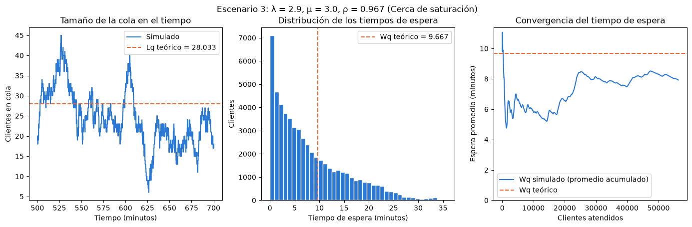
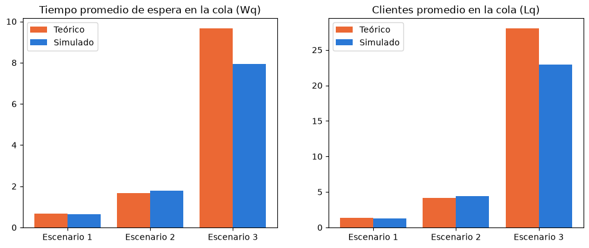

# Simulación de un sistema de colas M/M/1 con SimPy


Práctica N.º 03 de la asignatura **Simulación**, carrera de Computación de la
Universidad Nacional de Loja. Simula una línea de espera M/M/1, anima en la consola
cómo avanza la cola FIFO y compara los resultados simulados con los valores teóricos.

---

## Contenido

1. [Descripción del proyecto](#1-descripción-del-proyecto)
2. [Tecnologías utilizadas](#2-tecnologías-utilizadas)
3. [Instalación](#3-instalación)
4. [Configuración](#4-configuración)
5. [Uso](#5-uso)
6. [Estructura del proyecto](#6-estructura-del-proyecto)
7. [Información adicional](#7-información-adicional)

---

## 1. Descripción del proyecto

### Propósito

Simular un sistema de líneas de espera **M/M/1** y analizar el comportamiento de los
clientes, la cola y el servidor. El sistema tiene estas características:

- Las llegadas siguen un proceso de **Poisson**: el tiempo entre llegadas es exponencial con tasa λ.
- Los tiempos de servicio son **exponenciales**, con tasa μ.
- Hay **un único servidor**.
- Los clientes se atienden en orden **FIFO**: el primero en llegar es el primero en ser atendido.

### Problema que resuelve

Las fórmulas teóricas dicen cómo se comporta la cola *en promedio*, pero no muestran
cómo evoluciona minuto a minuto ni cuánto se alejan los datos reales de ese promedio.
El programa:

- Calcula las métricas teóricas **ρ, L, Lq, W y Wq**.
- Simula el sistema con SimPy y obtiene esas mismas métricas a partir de los datos.
- Compara los dos resultados con su **error porcentual**.
- Muestra en la consola, en vivo, cómo los clientes llegan, esperan y salen.
- Guarda las gráficas de cada escenario para el informe.

### Modelo matemático

| Medida | Fórmula | Significado |
|---|---|---|
| ρ  | λ / μ | Utilización del servidor |
| L  | λ / (μ − λ) | Clientes promedio en el sistema |
| Lq | λ² / [μ (μ − λ)] | Clientes promedio en la cola |
| W  | 1 / (μ − λ) | Tiempo promedio en el sistema |
| Wq | λ / [μ (μ − λ)] | Tiempo promedio de espera en la cola |

El sistema solo es estable si **λ < μ** (ρ < 1). Si no se cumple, el programa muestra
*"El sistema no es estable"* y no simula ese escenario.

---

## 2. Tecnologías utilizadas

| Tecnología | Versión probada | Para qué se usa |
|---|---|---|
| **Python** | 3.14 | Lenguaje del proyecto |
| **SimPy** | 4.1.2 | Simulación de eventos discretos (llegadas, cola y servidor) |
| **NumPy** | 2.5.3 | Generación de tiempos aleatorios exponenciales con semilla |
| **Matplotlib** | 3.11.2 | Gráficas PNG de cada escenario y de la comparación |
| `threading` y `queue` | biblioteca estándar | Simulación en un hilo y animación en otro |

Se necesita una terminal que muestre colores ANSI: la de Linux, la de macOS o la de VS Code.

---

## 3. Instalación

**Requisitos:** Python 3.10 o superior y `pip`.

```bash
# 1. Entrar a la carpeta de la práctica (dentro de ~/simulacion)
cd practica3

# 2. (Recomendado) Crear y activar un entorno virtual
python3 -m venv .venv
source .venv/bin/activate        # Windows: .venv\Scripts\activate

# 3. Instalar las dependencias
pip install -r requirements.txt
```

Contenido de `requirements.txt`:

```
simpy
numpy
matplotlib
```

---

## 4. Configuración

Todo lo configurable está en **`codigo/main.py`**. Si cambias un valor, cambian los resultados
de la práctica. No hace falta tocar ningún otro archivo.

### Escenarios

```python
ESCENARIOS = [
    {"lam": 2.0, "mu": 3.0, "condicion": "Sistema estable"},
    {"lam": 2.5, "mu": 3.0, "condicion": "Mayor utilización"},
    {"lam": 2.9, "mu": 3.0, "condicion": "Cerca de saturación"},
]
```

Se pueden agregar, quitar o cambiar escenarios en esta lista.

### Parámetros

| Parámetro | Valor | Descripción |
|---|---|---|
| `TIEMPO_SIMULACION` | 20 000 | Minutos simulados para calcular los resultados |
| `TIEMPO_CALENTAMIENTO` | 500 | Minutos iniciales que no se cuentan, porque el sistema empieza vacío |
| `SEMILLA` | 42 | Semilla aleatoria: con la misma semilla siempre salen los mismos resultados |
| `MINUTOS_ANIMADOS` | 120 | Minutos que se muestran paso a paso en la consola |
| `MINUTOS_POR_PASO` | 1 | Minutos simulados que avanza cada paso de la animación |
| `SEGUNDOS_POR_PASO` | 0.15 | Duración real de cada paso (menos = más rápido) |
| `SEGUNDOS_ENTRE_ESCENARIOS` | 2 | Pausa para leer los resultados antes del siguiente escenario |
| `ALTO_GRAFICA` | 10 | Filas de la gráfica de texto de la consola |
| `CLIENTES_VISIBLES` | 10 | Clientes de la cola que se dibujan |
| `CARPETA_GRAFICAS` | `"graficas"` | Carpeta donde se guardan las imágenes |
| `VENTANA_GRAFICA_COLA` | 200 | Minutos mostrados en la gráfica PNG de la cola |

> **Nota:** la gráfica de la consola dibuja una columna por paso. Con 120 pasos ocupa
> unos 131 caracteres de ancho. Si la terminal es más angosta, agrándala o usa
> `MINUTOS_POR_PASO = 2`.

---

## 5. Uso

Se ejecuta **desde la carpeta `practica3/`** (no desde dentro de `codigo/`):

```bash
python codigo/main.py
```

> Ejecutar desde `practica3/` hace que `CARPETA_GRAFICAS = "graficas"` apunte a
> `practica3/graficas/`, fuera de `codigo/`. Si ejecutas dentro de `codigo/`, las
> imágenes caerían dentro de `codigo/graficas/` y romperían la regla de que esa
> carpeta solo contiene archivos `.py`.

No hay que presionar nada. Al ejecutarlo:

1. Empieza el **escenario 1**. La consola se actualiza en el mismo lugar y muestra:
   - una **barra de progreso** verde con el minuto actual,
   - la **cola FIFO**: `Llegan → [ C9 C8 C7 ] → [ Servidor: C6 ] → Salen`,
   - una **gráfica de barras** de los clientes en cola, con la línea del Lq teórico,
   - la **espera promedio** simulada frente al Wq teórico.
2. Al terminar se muestra la **tabla teórico vs. simulado** con el error porcentual
   y se guarda `graficas/escenario_1.png`.
3. Continúa automáticamente con el **escenario 2**, después con el **3**, y así con
   todos los escenarios configurados.
4. Al final aparece la **comparación de todos los escenarios** y se guarda
   `graficas/comparacion.png`.

Para detener el programa: `Ctrl + C`.

---

## 6. Estructura del proyecto

El proyecto sigue la arquitectura **MVC (Modelo – Vista – Controlador)**:

```
practica3/
├── README.md               Este archivo
├── requirements.txt        Dependencias
├── codigo/                 Solo código Python (.py)
│   ├── main.py             Configuración y punto de inicio
│   ├── modelo/             Datos: solo clases con sus atributos
│   │   ├── escenario.py    λ, μ, tiempo, condición; calcula ρ y si es estable
│   │   ├── cliente.py      Llegada, inicio de servicio y salida de cada cliente
│   │   ├── estado.py       Tamaño de la cola y del sistema en un instante
│   │   ├── foto.py         Servidor y cola FIFO en un instante (para la animación)
│   │   ├── metricas.py     ρ, L, Lq, W, Wq
│   │   └── resultado.py    Resultados teóricos y simulados de un escenario
│   ├── controlador/        Lógica
│   │   ├── simulador.py    Simulación con SimPy (sigue el pseudocódigo de la guía)
│   │   ├── teoria.py       Fórmulas teóricas M/M/1
│   │   ├── estadisticas.py Promedios ponderados por tiempo y error porcentual
│   │   └── controlador.py  Ejecuta los escenarios con hilos y coordina la vista
│   └── vista/              Presentación
│       ├── consola.py      Animación, barra de progreso y tablas en la terminal
│       └── graficas.py     Gráficas PNG con Matplotlib
└── graficas/               Imágenes generadas al ejecutar (fuera de codigo/)
```

### Flujo de ejecución



### Cómo se calculan los resultados

- **L, Lq y ρ:** promedios ponderados por tiempo. Cada valor de la cola se multiplica
  por el tiempo que duró y se divide para el tiempo total observado.
- **W y Wq:** promedio de los tiempos individuales de cada cliente.
- **Calentamiento:** no se cuentan los primeros minutos, porque el sistema arranca
  vacío y todavía no representa su comportamiento normal.

### Uso de hilos

- Un **hilo de fondo** simula los escenarios uno tras otro y entrega cada resultado
  en una `queue.Queue`, que es segura entre hilos.
- El **hilo principal** anima cada escenario apenas su resultado está listo. Mientras
  se anima el escenario 1, el 2 ya se está simulando.
- Los procesos de SimPy (llegadas y atención) son concurrencia en *tiempo simulado*
  dentro de un solo hilo. Los hilos se usan para hacer dos cosas a la vez en
  *tiempo real*: calcular y mostrar.

---

## 7. Información adicional

### Funcionalidades

- ✅ Modelo M/M/1 con SimPy: un servidor y atención FIFO
- ✅ Tiempos entre llegadas y de servicio exponenciales, con semilla reproducible
- ✅ Métricas teóricas y simuladas: ρ, L, Lq, W y Wq
- ✅ Error porcentual entre teoría y simulación
- ✅ Animación en consola de la cola FIFO, con barra de progreso
- ✅ Detección de escenarios inestables (λ ≥ μ)
- ✅ Simulación y animación en hilos separados
- ✅ Gráficas PNG por escenario y gráfica comparativa

### Resultados obtenidos

Con 20 000 minutos, 500 de calentamiento y semilla 42:

| Escenario | λ | μ | ρ | Wq teórico | Wq simulado | Lq teórico | Lq simulado |
|---|---|---|---|---|---|---|---|
| 1 | 2.0 | 3.0 | 0.667 | 0.6667 | 0.6568 | 1.3333 | 1.3091 |
| 2 | 2.5 | 3.0 | 0.833 | 1.6667 | 1.7709 | 4.1667 | 4.4257 |
| 3 | 2.9 | 3.0 | 0.967 | 9.6667 | 7.9234 | 28.0333 | 22.8921 |

**Análisis:**

- Cuando λ se acerca a μ, la utilización tiende a 1 y **el tiempo de espera y el
  tamaño de la cola crecen muy rápido**. Del escenario 2 al 3, λ sube solo de 2.5 a
  2.9, pero Wq pasa de 1.67 a 9.67 minutos.
- La diferencia con la teoría es mayor en el escenario 3 (cerca de 18 %). Esto no es
  un error del programa: cerca de la saturación la cola varía muchísimo, con rachas
  largas de cola alta o baja, y una sola corrida puede alejarse bastante del promedio
  teórico. Con la semilla 42, incluso 100 000 minutos siguen dando cerca de 18 %. En
  una prueba aparte, el **promedio de 10 corridas independientes** (semillas distintas)
  de 100 000 minutos quedó a menos de 3 % del valor teórico.

### Capturas

**Animación en consola** (escenario 3):

```
==============================================================================
ESCENARIO 3 de 3  |  λ = 2.9  μ = 3.0  ρ = 0.967  |  Cerca de saturación
==============================================================================
  Progreso ████████████████████░░░░░░░░░░░░░░░░░░░░  50.0%  (minuto 60 de 120)

COLA FIFO (el primero en llegar es el primero en ser atendido)
  Llegan → [ +18 C174 C173 C172 C171 C170 C169 C168 C167 C166 C165 ] → [ Servidor: C164 ] → Salen

CLIENTES EN LA COLA (····· = Lq teórico 28.033)
    32.0 |                                              █
    28.8 |·············································██··············
    22.4 |                   █████          █ ████ ██ █████████████████
    16.0 |              ███████████████   █████████████████████████████
     9.6 |          ███████████████████████████████████████████████████
         +-------------------------------------------------------------
TIEMPO PROMEDIO DE ESPERA EN LA COLA (Wq)
  Simulado  █████████████████████                    5.831
  Teórico   ████████████████████████████████████     9.667
```

**Gráficas generadas** (`graficas/`):

| Escenario 1 | Escenario 2 |
|---|---|
|  |  |

| Escenario 3 | Comparación |
|---|---|
|  |  |

Cada imagen de escenario contiene:
1. el tamaño de la cola en el tiempo, frente al Lq teórico;
2. el histograma de los tiempos de espera, frente al Wq teórico;
3. la convergencia del promedio acumulado de Wq hacia el valor teórico.

### Datos académicos

| | |
|---|---|
| **Universidad** | Universidad Nacional de Loja — FEIRNNR |
| **Carrera** | Computación — Ciclo 5 |
| **Asignatura** | Simulación |
| **Práctica** | N.º 03 — Simulación de un sistema de líneas de espera M/M/1 mediante SimPy |
| **Docente** | José O. Guamán Q. |
| **Autor** | Galvez Emilio |

### Licencia

Proyecto de uso académico, desarrollado como parte de la práctica de la asignatura Simulación.
